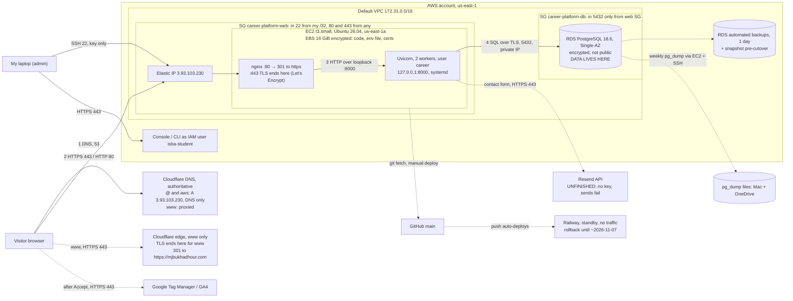
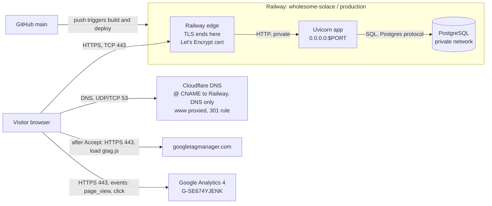
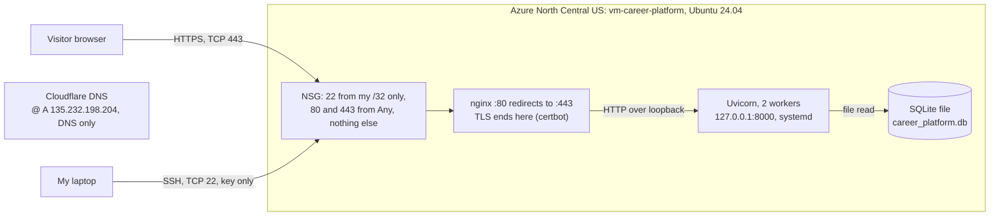
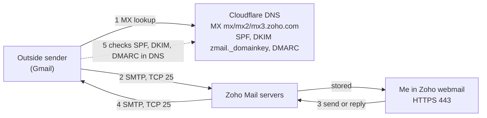

# Career Platform

My personal resume site, and the start of the career platform I'll build
this semester. It's a FastAPI app with Jinja templates and plain CSS that reads
my profile and projects from a database on every request.

**Live:** https://mjbukhadhour.com on **AWS** (EC2 + Single-AZ RDS PostgreSQL)
since 2026-11-05 about 23:07 UTC. `www` redirects to it. The full migration
record is [`docs/aws-migration.md`](docs/aws-migration.md).
**Previous host, still running:** Railway + PostgreSQL, the rollback target
until its trial ends around 2026-11-07.
**Earlier host:** Azure VM `vm-career-platform` (SQLite), until the instructor's
cleanup directions.

Project 1 submission index: [`docs/project-1-submission.md`](docs/project-1-submission.md).

> **About this README.** It was written on 2026-10-25, after the work, with
> Claude Code reading the repo, Git history and saved evidence. It's a
> **retrospective** record. The plans it links to were written before each
> change. Claims link to the file, commit or check that supports them. Anything
> without proof is marked **unverified**. Today's re-run checks are in
> [`docs/evidence/project-1-checks-2026-10-25.md`](docs/evidence/project-1-checks-2026-10-25.md).
>
> **Update 2026-11-05 (AWS migration).** The AWS sections below (set up,
> architecture, migration, rollback, decision 3, costs, limitations) were added
> on 2026-11-05 from [`docs/aws-migration.md`](docs/aws-migration.md), which
> was written step by step during the migration. Sections about Railway and
> Azure describe those hosts as they were.

## What the site does

- Shows my name, introduction, education, experience (a labeled placeholder),
  skills and GitHub/LinkedIn links from `app/profile_content.py`, plus
  projects read from the database on every request.
- The one project entry is this website, described as a project in progress.
- Has a Privacy page, a cookie banner, and GA4 that loads only after Accept
  (commit `e7caa8c`).
- Has a contact form built for Resend. Delivery needs a Resend key, which is
  out of scope for Project 1. Whether Railway has one is **unverified**.
- `/healthz` returns `{"status":"ok"}` without touching the database.

How the database is used. The profile is in code, so it never depends on the
database. Only projects are queried, on every request:

| Situation | Status | Page | Evidence |
| --- | --- | --- | --- |
| Healthy | 200 | Profile and projects; footer `Projects source: database` | [db-failure-recovery](docs/evidence/db-failure-recovery.md), test `test_healthy_database_shows_projects_with_200` |
| Projects table empty | 200 | Profile and "No projects published yet." | same file, `test_empty_projects_table_returns_200_with_empty_message` |
| Projects query fails | 503 | Profile still shown, with "Projects temporarily unavailable". No cached or sample content | same file, `test_database_failure_keeps_profile_and_returns_503` |
| Database comes back | 200 on the next request, no restart | Projects again | same file (same process ID before and after), `test_next_request_recovers_without_restart` |

A failed query isn't remembered. Each request opens a new session. File-based
SQLite uses no connection pool, so a missing file shows up on the next
request. PostgreSQL uses `pool_pre_ping` and a 5-second connect timeout
(`app/db.py`). The earlier snapshot fallback and full-page 503 were removed,
because they hid the profile or served saved content. Verified locally
on SQLite on 2026-10-25. A PostgreSQL outage on Railway was **not** tested.

The initial database was SQLite because the course's build plan required it
([original plan](docs/superpowers/plans/2026-09-23-personal-resume-career-platform-plan.md),
line 25). The original design spec had proposed Next.js and PostgreSQL
([spec](docs/superpowers/specs/2026-09-23-personal-resume-career-platform-design.md)).
SQLite needs no server, which fit a single small VM. Railway uses PostgreSQL.

## Set up and update

### Local

```bash
uv sync                      # or: pip install -e '.[dev]'
cp .env.example .env         # local default is SQLite; never commit .env
uv run alembic upgrade head
uv run python -m app.seed    # local only, never on Railway
uv run uvicorn app.main:create_app --factory --reload --host 0.0.0.0 --port 8000
curl -fsS http://localhost:8000/healthz
uv run pytest -q             # 34 passed on 2026-10-25
```

Set `RESEND_API_KEY`,
`CONTACT_FROM` and `CONTACT_TO` in `.env` only when testing contact delivery.
Never commit `.env`, SQLite files, backups, or provider credentials.

### AWS (live)

EC2 `i-04af2fcbbe7761894` (t3.small, Ubuntu 26.04, Elastic IP `3.93.103.230`)
runs the app as the non-root user `career` from `/srv/career-platform`, under
systemd ([`deploy/career-platform.service`](deploy/career-platform.service)),
behind Nginx ([`deploy/nginx-career-platform.conf`](deploy/nginx-career-platform.conf)).
The only setting is `DATABASE_URL`, pointing at RDS `career-platform-db`. It
lives in `/etc/career-platform/env` (root, mode 600) and never in Git.

**There's no automatic deploy.** Pushing to `main` doesn't change AWS. To deploy
a reviewed commit:

```bash
ssh -i ~/.ssh/career-platform-ec2 ubuntu@3.93.103.230
cd /srv/career-platform
sudo -u career git fetch && sudo -u career git checkout <reviewed-sha>
sudo -u career env HOME=/srv/career-platform uv sync --frozen --no-dev
sudo sh -c 'set -a; . /etc/career-platform/env; set +a; exec sudo -u career --preserve-env=DATABASE_URL .venv/bin/alembic upgrade head'
sudo systemctl restart career-platform && curl -s http://127.0.0.1:8000/healthz
```

Then check https://mjbukhadhour.com. SSH only accepts my current IP. If my IP
changes, update the port 22 rule in security group `career-platform-web`.

### Railway (previous host, rollback until about 2026-11-07)

Railway deploys `main` from GitHub automatically, so pushing to `main`
still redeploys Railway, docs included, while the project exists.
[`railway.json`](railway.json) holds the deploy config:

- pre-deploy: `alembic upgrade head`. It creates or upgrades the schema, and a failed migration fails the deploy.
- start: Uvicorn on `0.0.0.0:$PORT`, trusting Railway's forwarded headers.
- health check: `/healthz`.

`DATABASE_URL` is a Railway service variable, never in Git. The live page
reads its rows, so it points at the PostgreSQL data, but its exact setup in
the dashboard isn't recorded here.

To update: change the code, run `uv run pytest -q` and `uv run ruff check .`,
review `git diff`, commit, and push to `main`. Then check the new deployment in
Railway and the behaviour at https://mjbukhadhour.com. Railway's deployment
history is mirrored on GitHub
(`https://api.github.com/repos/mbukhadh/career-platform/deployments`).

**Docs-only commits are deployed too.** There are no watch paths in
`railway.json`, so every push to `main` redeploys, docs included: `034c890`,
`8550408`, `81403ba`, and on 2026-10-25 `8281f58`, which deployed with
success 52 seconds after the push
([checks §2 and §5](docs/evidence/project-1-checks-2026-10-25.md#5-final-push-and-railway-deployment)).
One exception: `6dd6af4` and `14df95e` (2026-10-20) have no deployment record.
The cause is **unverified**, and the commits after them deployed normally.

### Azure VM (previous host)

Set up by [`2026-09-24-azure-vm-migration.md`](docs/superpowers/plans/2026-09-24-azure-vm-migration.md)
and [`2026-10-01-operate-the-vm.md`](docs/superpowers/plans/2026-10-01-operate-the-vm.md).
HTTPS is explained in my Ex04 write-up,
[`docs/how-this-site-is-secured.md`](docs/how-this-site-is-secured.md). To update:

```bash
ssh -i ~/.ssh/isba4775_azure azureuser@135.232.198.204
cd ~/career-platform && git pull && uv sync --locked --no-dev
sudo systemctl restart career-platform && curl -s http://127.0.0.1:8000/healthz
```

## Architecture

The request path from a laptop to each host, with ports, NAT and DNS, is in
[`docs/request-path-diagram.md`](docs/request-path-diagram.md)
([Railway PNG](docs/images/request-path-railway.png),
[Azure PNG](docs/images/request-path-azure.png)). The summary below adds the
email and analytics paths.

### AWS (current, since 2026-11-05)

Checked against the live deployment on 2026-11-05 (evidence:
[`docs/aws-migration.md` §9](docs/aws-migration.md#9-architecture-diagram-2026-11-05)).
Dashed arrows are background, admin, standby or unfinished paths, and solid
arrows are the request path.



**How to read it.**

1. **Finding the server.** A visitor's browser asks Cloudflare's DNS where
   `mjbukhadhour.com` is. The apex record is **DNS only** (gray cloud), so
   Cloudflare just answers with the Elastic IP, and the browser then connects
   **straight to AWS**. Cloudflare isn't in that path.
2. **HTTPS.** The connection passes the web security group, which allows
   only 80 and 443 from anyone and 22 from my IP. **nginx on EC2 is where
   HTTPS ends**, using a Let's Encrypt certificate that `certbot.timer` renews.
   Plain HTTP on port 80 only gets a 301 redirect to https.
3. **The app.** nginx passes the request over the loopback address to
   Uvicorn on `127.0.0.1:8000`. That port can't be reached from outside.
   Uvicorn runs as the non-root user `career` under systemd.
4. **The data.** The app reads RDS over TLS on port 5432 at a private IP. The
   database security group only accepts the web security group, and RDS isn't
   publicly accessible. **The data lives in RDS.** The EC2 disk holds only the
   code, the env file with `DATABASE_URL`, and the certificates.

- **`www` is different.** It's **proxied** (orange cloud), so browsers connect
  to Cloudflare's edge. TLS ends there, with Cloudflare's own certificate, and
  Cloudflare answers with a 301 to the apex. It never reaches AWS.
- **Backups:** RDS keeps automated backups for only 1 day (a Free plan limit),
  plus a manual pre-cutover snapshot. The weekly `pg_dump` copies on my Mac
  and OneDrive are the main safety net.
- **Admin access:** SSH with a key from my laptop only, and the AWS console
  or CLI as the course IAM user. Deploys are manual: EC2 fetches a reviewed
  commit from GitHub.
- **Railway is standby.** It got no outside requests after the DNS change
  (23:07 UTC), but pushes to `main` still deploy to it until it's deleted.
- **Unfinished:** the contact form has no Resend key, so sending fails on the
  server before any request leaves it, the same as on Railway.

### Railway (previous, rollback until about 2026-11-07)



### Azure (previous)



Public IP `135.232.198.204`, private IP `172.16.0.4`. Rules as of 2026-10-25
are in [checks §3](docs/evidence/project-1-checks-2026-10-25.md#3-azure-vm).

### Email (Zoho, same for every host)



Mail never touches AWS, Railway or Azure. Only DNS ties them together. The
AWS cutover changed only the apex record, and MX, SPF, DKIM and DMARC are
unchanged (checked against the Cloudflare zone export on 2026-11-05).

### Analytics (GA4)

1. The page from Railway includes `static/js/consent.js`. Nothing goes to Google yet.
2. When the visitor clicks Accept, the script loads `gtag.js` from
   `www.googletagmanager.com` over HTTPS and configures `G-SE674YJENK`.
3. The browser sends events straight to Google Analytics over HTTPS:
   `page_view` on load, and `click` with `outbound: true` and `link_url` for
   links to other sites (Enhanced measurement).
4. GA4 Realtime and Tag Assistant show the events. The server never sees them.

What I checked on 2026-10-15 ([ex06 §3](docs/evidence/ex06.md#3-live-site-and-ga4)):
I loaded the live page and clicked the LinkedIn link in the header. Realtime
showed `page_view` and `click`, and Tag Assistant showed the click with
`link_domain: linkedin.com` and `outbound: true`. After adding the consent
banner, I repeated it from a private phone tab with Accept
([screenshot](docs/evidence/ga4-after-consent.png)). This shows the tag
fires on the live domain and that the interaction is attributed to the right
link. It doesn't show anything about visitor numbers.

Why the outbound click matters: the site exists to send recruiters on to my
LinkedIn, GitHub and project. A page view says someone arrived, and the
outbound click says they took the next step.

Decline deletes the `_ga` cookies (commit `e7caa8c`).

## Migration: Azure VM to Railway

The plan was written before the deployment changed:
[spec](docs/superpowers/specs/2026-10-08-railway-postgres-migration-design.md)
and [plan](docs/superpowers/plans/2026-10-08-railway-postgres-migration.md),
commit `c9f93bc` (2026-10-08). The code changes in `d4bee5f` came first.

**What Git moved:** the code, `uv.lock` (packages), the Alembic schema, and
`railway.json` (runtime and start config). **What Git didn't move:** the data
(SQLite is ignored by Git), the secrets (Railway variables), DNS (Cloudflare,
by hand), and TLS (Railway issues its own certificate).

**How the data was kept:**

1. On 2026-10-08, a consistent `.backup` of the VM's SQLite file was taken and
   copied to my laptop, outside the repo. SHA-256 matched and
   `integrity_check` returned `ok` (plan §1).
2. Railway built the schema with `alembic upgrade head`. No seed step runs on Railway.
3. `python -m app.transfer` copied every table in one transaction through
   SQLAlchemy, which converts SQLite text dates and 0/1 values to PostgreSQL
   types. The transfer's own output wasn't saved.
4. `--compare` hashed every row on both sides: all 9 tables match
   ([data comparison](docs/evidence/railway-data-comparison.md), commit
   `8550408`, 2026-10-13).

**No real data edit was made before the migration.** The VM's data was
itself created by `app/seed.py` (see [ex03](docs/evidence/ex03.md)), and no
row was changed before the transfer. So the matching comparison doesn't prove
the rows were transferred rather than reseeded. The assignment asks for one
real change first to rule that out. **That was not done.**

**Cutover:** the apex record moved from A `135.232.198.204` (recorded
2026-10-13 22:06 UTC in [dns-after-zoho](docs/evidence/dns-after-zoho.md)) to
a DNS-only CNAME to Railway. Railway's certificate was issued 2026-10-15 21:29
UTC. The exact time of the DNS change wasn't recorded. Post-cutover checks are
in [checks §1](docs/evidence/project-1-checks-2026-10-25.md#1-domain-and-https-railway).

### Who manages what

| | Azure VM | Railway |
| --- | --- | --- |
| OS and patches | Me (Ubuntu updates) | Railway |
| Runtime (Python) | Me (`uv sync` on the VM) | Railway builds it; I pin packages with `uv.lock` |
| Web entry point | Me: nginx, NSG rules | Railway edge |
| TLS certificate | Me: certbot and its timer | Railway issues and renews |
| Application code | Me | Me (push to `main`) |
| Configuration and secrets | Me: `.env` on the VM, systemd unit | Me: Railway variables, `railway.json` |
| Database software | Me (SQLite file on disk) | Railway runs PostgreSQL |
| Data and backups | Me | Me: Railway runs the server, but backups, schema changes and correctness are mine |
| DNS | Me (Cloudflare) | Me (Cloudflare) |

PaaS still leaves me the code, secrets, schema migrations, data, DNS,
costs, and noticing when something breaks. For example, whether the
database is reachable from the internet is my job to check, and that's
unresolved right now (see limitations).

## Migration: Railway to AWS (2026-11-05)

The full record, with commands, checks and evidence, is
[`docs/aws-migration.md`](docs/aws-migration.md). It was written step by step
and follows the course guide.

| Step | What happened | Evidence |
| --- | --- | --- |
| Plan and cost | EC2 + Single-AZ RDS, estimated about $34 a month against $120 in credits that expire Apr 29, 2027 | §1, §5 |
| Backup | `pg_dump` through `railway connect Postgres --tunnel-only`. Restored locally and compared table by table. Copies on the Mac and OneDrive | §2 |
| Build | EC2 with IMDSv2, encrypted gp3 and Standard credits. RDS 18.6, private, encrypted. Each resource was created once, after console review | §5 |
| Deploy | Nginx → Uvicorn (non-root, systemd) → RDS over TLS. Restored the Nov 3 dump from EC2, and all 10 tables matched | §6 |
| Test | `aws.mjbukhadhour.com` with Let's Encrypt. Pages byte-identical to Railway. A test record survived an app restart and a reboot. Renewal dry-run. SSH and RDS restrictions verified | §7 |
| Cutover | Elastic IP. Apex certificate by DNS-01 before the move. Edit freeze, final dump (identical data), pre-cutover RDS snapshot, restore. The apex **CNAME to Railway was replaced by an A record** to `3.93.103.230`. Automatic renewal set up afterwards | §8 |

**How the data was kept:**

1. The final Railway dump (`railway-20261105T225854Z.dump`, SHA-256
   `b801a7ff…7137706a`) was restored into an empty RDS database from EC2.
2. An MD5 of every table on RDS matched a local restore of the same dump.
3. The app has no write path, so an edit freeze was enough to stop competing
   writes.
4. Production pages on AWS were byte-identical to Railway after the switch.

**Deviation:** the AWS Free plan only allows **1 day** of RDS automated
backups (7 was refused). Weekly `pg_dump` copies outside AWS are the main
safety net.

### Next step (AWS)

In order:

1. **Lift the edit freeze.** Content edits have been frozen since the final
   Railway dump (2026-11-05 22:58 UTC). Once I accept the verification in
   [`docs/aws-migration.md`](docs/aws-migration.md) §8 and §9, edit content
   only on AWS (RDS). Take a `pg_dump` before any edit.
2. **Check actual costs.** In Billing → Bills, Cost Explorer and Credits
   (from 2026-11-06, since charges show up about a day late), compare against
   the estimate of about $34 a month and the $120 credits. My IAM user can't
   read billing, so this is done in the console.
3. **Delete the `_acme-challenge` TXT record** in Cloudflare. It was only
   needed for the DNS-01 certificate before cutover. Renewal now uses HTTP-01
   through Nginx.
4. **Remove the Railway SSH key** `mac-railway-cli`:
   `railway ssh keys remove SHA256:U4JoTMMo6ysQLTtioyjtYF9NAyWGrgIfB8cBOOzmhe0`
   (add `--2fa-code <code>` if asked). After this, the Railway tunnel stops
   working.
5. **Delete the Railway project before about 2026-11-07,** when the trial
   ends. Do it only after keeping backups: the final Railway dump
   `railway-20261105T225854Z.dump` and the RDS dump
   `rds-20261105T231452Z.dump` are on the Mac and OneDrive with checksums.
   Rollback to Railway ends at that point, and so does the old public
   database address (see limitations).
6. **Course-end cleanup**, to stop all AWS charges:
   1. Take a fresh `pg_dump` and keep it outside AWS.
   2. Turn off RDS deletion protection, then delete `career-platform-db`
      **with a final snapshot**. Don't just stop it: a stopped RDS instance
      restarts itself after 7 days.
   3. Terminate EC2 `i-04af2fcbbe7761894`. Its encrypted volume is deleted
      with it.
   4. Release Elastic IP `3.93.103.230` (`eipalloc-0aaa3c6cdf86082df`). It
      bills even when not attached.
   5. Delete the security groups `career-platform-db` and
      `career-platform-web`, the DB subnet group and the key pair. Decide
      whether to keep the snapshots.
   6. Point or remove the `@` and `aws` DNS records.
   7. Run `aws logout --profile isba-4775`.

## Verified website update (requirement 5)

| | |
| --- | --- |
| Change | Keep the profile visible when the projects query fails ("Projects temporarily unavailable", 503); remove the snapshot fallback |
| Commit | [`10c43e3`](https://github.com/mbukhadh/career-platform/commit/10c43e3f3ebf077a41eb809541c5017497f72c15), branch `feat/projects-unavailable`, fast-forwarded into `main` |
| Review | **Reviewed by me (MJ)** on 2026-10-25: I read `git diff main...HEAD` on the branch and approved it before the merge. Approval was given in my Claude Code session; there is no GitHub pull request |
| Local verification before merge | `uv run pytest -q`: 34 passed; `ruff check` clean; failure and recovery reproduced in one process ([db-failure-recovery](docs/evidence/db-failure-recovery.md)) |
| Pushed | 2026-10-25 23:31:54 UTC |
| Railway deployment | ID `7320808074`, environment `wholesome-solace / production`: `in_progress` 23:31:57 UTC, `success` 23:32:31 UTC (GitHub deployments API) |
| Live check | 2026-10-25 23:32:46 UTC, below |

```text
$ curl -s -o live.html -w "HTTP %{http_code}\n" https://mjbukhadhour.com/
HTTP 200
$ grep -oE '<h1>[^<]*</h1>|<h3>Career Platform</h3>|Projects source: database|Profile source: [a-z]+' live.html
<h1>Mohammad (MJ) Bukhadhour</h1>
<h3>Career Platform</h3>
Projects source: database
$ curl -sI https://mjbukhadhour.com/ | grep -i server
server: railway-hikari
$ curl -s https://mjbukhadhour.com/healthz
{"status":"ok"}
$ curl -s -o /dev/null -w "%{http_code}\n" https://mjbukhadhour.com/profiles/missing
404
```

What changed at the domain: before the deploy (2026-10-25 23:11 UTC,
[checks §1](docs/evidence/project-1-checks-2026-10-25.md#live-page-reads-the-database))
the footer read `Profile source: database`. After the deploy it reads
`Projects source: database`, and the project still loads from Railway
PostgreSQL with 200. The failure path (503) was verified locally only. I
didn't stop Railway's database to show it live.

## Rollback

### Application code

1. Fastest: in Railway, open **Deployments**, pick the last good deployment
   (its commit SHA is shown, and on GitHub), and choose **Redeploy**. The site
   is back in about a minute, but `main` still has the bad code.
2. Then fix history: `git revert <bad sha>`, run the tests, and push. Railway
   deploys the revert, so Git and the live site agree again.
3. Check `https://mjbukhadhour.com/healthz` and the page.

**For the reviewed change `10c43e3`:** to undo it, run `git revert 10c43e3`,
then `uv run pytest -q`, then push to `main`. Or redeploy the previous
deployment in Railway (commit `53fcead`). Then check that the footer reads
`Profile source: database` again.
- **Database impact: none.** The change has no migration and doesn't write
  to the database. The profile tables are still in the schema and still hold
  their rows, so the old code reads them again as soon as it's back.
- The revert brings back the snapshot fallback and the full-page 503, so
  requirement 1 would be unmet again.

### Database

- **Schema:** every schema change is an Alembic migration that runs in
  pre-deploy. If it fails, the deploy fails and the old version keeps serving.
  Before a risky migration, take a `pg_dump` from Railway. To undo one,
  run `alembic downgrade -1` against Railway. The only migration so far,
  `0001`, downgrades by dropping every table, so never run that one on live data.
- **Data:** the site has no write path today (no admin page; the contact form
  doesn't store anything), so live data only changes when I change it.
  Recovery sources, newest first:
  1. A `pg_dump` taken before the change.
  2. Railway's backups. Whether these exist on the trial is **unverified**.
  3. The 2026-10-08 VM backup in `~/career-platform-backups/`, loaded into an
     empty database with `python -m app.transfer`.
- Code and data roll back together when a migration is involved. Restore the
  data or downgrade first, then redeploy the matching code.

### Whole site back to Railway (until about 2026-11-07)

1. **Before any content edit on AWS:** in Cloudflare, replace the apex A
   record with `CNAME @ → eub1ntkd.up.railway.app`, DNS only. That's the exact
   line in the saved zone export
   (`~/Backups/career-platform/cloudflare-zone-mjbukhadhour.com-20261105.txt`).
2. Wait out the TTL (up to 5 minutes), then check that `server:
   railway-hikari` answers. Railway still has identical data.
3. **After edits on AWS:** first take a `pg_dump` of RDS from EC2, restore it
   into Railway through the tunnel, and compare the tables. Then switch DNS.
4. After the Railway trial ends, this path is gone. The AWS undo points are
   the RDS snapshot `career-platform-db-pre-cutover` and the `pg_dump` files.

### AWS data

- **Undo the restore:** restore RDS from snapshot `career-platform-db-pre-cutover`,
  or restore a `pg_dump` from EC2 (`pg_restore --no-owner --no-privileges`).
- **Weekly backup** (from the Mac, prints no secrets): see
  [`docs/aws-migration.md` §8](docs/aws-migration.md#deviation-rds-automated-backups-are-1-day-not-7).
  RDS automated backups keep only 1 day.

### Whole site back to Azure

1. In Cloudflare, set `@` back to an A record at `135.232.198.204`, DNS only.
2. Check `https://mjbukhadhour.com` serves the VM (`server: nginx`).
3. If Railway has taken writes since cutover, compare both databases first
   (`python -m app.transfer --compare`) and copy the newer rows back. Today
   there are none, because the app doesn't write.
4. The VM's certificate expires 2027-01-04. Certbot can't renew it while DNS
   points at Railway, so after early December, rolling back needs a manual
   `certbot` run once DNS is back on the VM.

## Decisions

### 1. How to move to Railway and PostgreSQL (2026-10-08, written before the work)

From the [migration spec](docs/superpowers/specs/2026-10-08-railway-postgres-migration-design.md#decisions):

- **Transfer script vs `pgloader` or a SQL dump.** I chose a SQLAlchemy
  transfer script with a row-hash compare. It converts types for me and proves
  the content matched. The other options needed manual boolean and date
  fixes and give no comparison.
- **psycopg 3 vs psycopg2.** I chose psycopg 3, the supported driver, and
  rewrite the URL in one place.
- **Config in `railway.json` vs the dashboard.** Keeping it in Git means the
  config is reviewed and versioned with the code.
- **Keep Azure running vs switch it off.** I kept it as the rollback target.

### 2. Managed (Zoho) vs self-hosted email (retrospective)

_Drafted with AI assistance (Claude), reviewed and edited by me on 2026-10-25._

I chose Zoho Mail (managed) over running my own mail server. Self-hosting means I would own the mail server software, its patching, spam reputation, and deliverability, and a misconfigured server can get my domain blocked. Zoho handles all of that; I only configure MX, SPF, DKIM, and DMARC in Cloudflare and verify the results. The trade-off is less control and dependence on Zoho’s free plan, which was acceptable for a resume address.

### 3. AWS: EC2 + Single-AZ RDS (written before the work)

From [`docs/aws-migration.md` §1](docs/aws-migration.md):

- I compared three options: EC2 with PostgreSQL on the VM, EC2 with RDS, and
  Lambda with API Gateway and RDS.
- I chose **EC2 + Single-AZ RDS** over EC2 with PostgreSQL on the VM because
  I'm optimizing for learning and want AWS to run the database (patching and
  backups). Lambda would have needed app changes.
- The trade-off is a second service and the largest cost line, RDS at about
  $14 a month.
- Single-AZ and no load balancer keep it inside the credits. The cost is no
  automatic failover.

## Investigated failures

**1. Application/database dependency: the database to migrate didn't exist (real failure, 2026-09-29 to 2026-10-06).**
Written up in [`docs/evidence/ex03.md`](docs/evidence/ex03.md) §3:

- **Symptom:** `career_platform.db` was missing from the Codespace.
- **Checks:** a filesystem search for `*.db`; the `.worktrees/` timestamp; `.gitignore`.
- **Diagnosis:** the database lived in a removed worktree, and Git ignores `*.db`.
- **Repair:** rebuilt from the seed, then copied the file to the VM with `scp`.
- **Repeat check:** matching SHA-256, `integrity_check ok`, `/healthz`, and the page heading.

That file also records a second slip: a quoting error skipped the backup before `scp`.

**2. DNS/TLS: wrong A record left on the old VM (deliberate lab simulation, 2026-10-13).**
Written up in [`docs/evidence/ex05.md`](docs/evidence/ex05.md). This was the course's
supplied simulation, not my system:

- **Symptom:** curl error 60, certificate name mismatch.
- **Checks:** `dig` and `curl -Iv`.
- **Diagnosis:** DNS sent clients to the old VM.
- **Repair:** a CNAME to Railway.
- **Repeat check:** CNAME → Railway IP, certificate CN matches, HTTP/2 200.

**Also (real):** on 2026-10-16, Namecheap suspended the domain over WHOIS
verification, and DNS stopped resolving. It was fixed by verifying the
registrant email, and recovery was confirmed on 2026-10-20. See the note in
[ex06](docs/evidence/ex06.md#note-domain-suspension).

## Reflection

_Drafted with AI assistance (Claude), reviewed and edited by me on 2026-10-25._

Doing this project showed me the difference between code working and a system being proven. The site ran on Azure and then Railway, but I could only claim things I had evidence for: the restart came from VM logs rather than a planned test, and the data comparison didn’t prove a transfer because I never edited the data before migrating. I now understand that PaaS removes the OS, runtime, and TLS work, but I still own the code, the secrets, the database data, DNS, and cleanup. The Railway Postgres proxy showed this: the dashboard said no public access while the address still answered, and I couldn’t resolve it. The reviewed change taught me that a requirement (“profile stays visible, projects fail with 503”) can mean redesigning the app, not just catching an error: the profile moved into code, and a SQLite connection-pool bug only appeared once I reproduced the failure myself. Next time I would edit the real data before migrating, run a planned reboot test on Azure, and keep evidence as I go instead of reconstructing it later.

## Costs, credits, expiration and cleanup

| Service | What's billable | Cost / credit | Expires or renews | Cleanup |
| --- | --- | --- | --- | --- |
| Azure for Students | VM `Standard_B2ats_v2` (compute, while running); 30 GB Standard SSD (E4) and a Standard public IP (billed even when deallocated) | Paid from student credit. Amount used and credit end date **unverified**: the CLI returns no cost, so check the portal | Credit end date **unverified** | Keep running until the instructor says. Then delete resource group `rg-career-platform` (VM, disk, IP, NIC, NSG, VNet, shutdown schedule) |
| AWS (account 355258598994, Free plan) | EC2 t3.small, 16 GiB gp3, Elastic IP (also billed while the instance is stopped), RDS db.t4g.micro with 20 GiB gp3, manual snapshot `career-platform-db-pre-cutover` | Estimated **about $34 a month**, paid from **$120 credits** (2026-11-03). At that rate the credits last until about mid-February 2027. Zero-spend budget alert is on. Actual charges are **unverified**: my IAM user can't read billing, so check Billing → Credits | Credits and the Free plan end **Apr 29, 2027** | When done: turn off RDS deletion protection, delete RDS with a final snapshot, terminate EC2, release the Elastic IP, then delete the security groups, DB subnet group and key pair |
| Railway | Web service and PostgreSQL usage | Trial: 30 days or $5 of usage, whichever comes first. **2026-10-25 16:39 PT: "13 days or $4.28 left"** (read from the Railway dashboard by me) | Trial ends about **2026-11-07**, or sooner if the $4.28 runs out. The Free plan allows no custom domain, so `mjbukhadhour.com` stops working on Railway after that **Migrated to AWS on 2026-11-05.** Kept as the rollback target. Delete the project once AWS is accepted, which also settles the old public database address (see limitations) |
| Domain `mjbukhadhour.com` (Namecheap) | Registration | Price **unverified** | Registered 2026-10-01, expires **2027-10-01** (WHOIS) | Renew or let lapse after the course |
| Cloudflare DNS | DNS, `www` redirect rule, edge certificate | Plan **unverified** in the dashboard (expected Free) | Edge cert valid to 2026-12-30, auto-renewed | Keep while the domain is used |
| Zoho Mail | One mailbox | Plan **unverified** in the dashboard (expected Forever Free) | none known | Keep; remove MX/SPF/DKIM/DMARC if dropped |
| Let's Encrypt | Railway cert (to 2027-01-13) and VM cert (to 2027-01-04) | Free | Railway renews its own; the VM's can't renew (see Rollback) | none |
| GA4 | Property `G-SE674YJENK` | Free | none | Delete the property if no longer used |

## Remaining limitations

**AWS (2026-11-05):**

- **RDS automated backups keep 1 day**, not 7. The Free plan refuses more, so weekly `pg_dump` copies are the main safety net.
- **Single-AZ, one instance.** There's no failover. A failure means restoring from a snapshot or dump (RTO about 1 hour, section 2).
- **Contact form email doesn't send** on AWS, and didn't on Railway either: no Resend key is set. Adding one is a separate change.
- **Actual AWS costs are unverified**, because the course IAM user can't read billing.
- **SSH only accepts one IP.** If my address changes, update the security group first.
- **Deploys are manual.** A push to `main` updates Railway, while it exists, but not AWS.

**Earlier hosts:**


- **Database failure was verified only locally on SQLite**
  ([db-failure-recovery](docs/evidence/db-failure-recovery.md)), not as a
  PostgreSQL outage on Railway.
- **No real data edit before migration.** The comparison can't tell a
  transfer from a reseed. Railway build and deploy logs from the first
  deploy weren't saved.
- **The data comparison was not re-run.** The 2026-10-13 comparison is the
  latest. On 2026-10-25 the saved credentials failed (`password
  authentication failed`), and my Railway dashboard shows no public access on
  the Postgres service, so I have no current public URL to compare against. I
  chose not to re-run it.
- **Public database access is unresolved.** On 2026-10-25 at about 16:41 PT, my
  Railway dashboard (Postgres › Settings › Networking) showed "Add Public
  Access" and no `DATABASE_PUBLIC_URL`. But at 16:42 PT, the old proxy
  address saved in my local `.env` still accepted connections, and a
  PostgreSQL server answered there
  ([checks §6](docs/evidence/project-1-checks-2026-10-25.md#6-public-database-access-and-live-site)).
  Next step: find which Railway service or project owns that address, and
  remove its public access.
- **The reviewed change was verified live only on the healthy path.** Its 503 path was tested locally, not against Railway.
- **The before-MX email test isn't recorded** in [ex06](docs/evidence/ex06.md).
- **Azure restart** evidence is a stop and start read from logs afterward,
  not a planned reboot test with an outside check.
- **The VM's certificate can't auto-renew** while DNS points at Railway.
- **Email hardening:** DKIM is 1024-bit and DMARC is `p=none`, which reports
  but doesn't enforce.
- **Railway trial ends about 2026-11-07.** The AWS migration was done on
  2026-11-05. Azure costs and the Cloudflare and Zoho plans are still
  **unverified** (see Costs).
