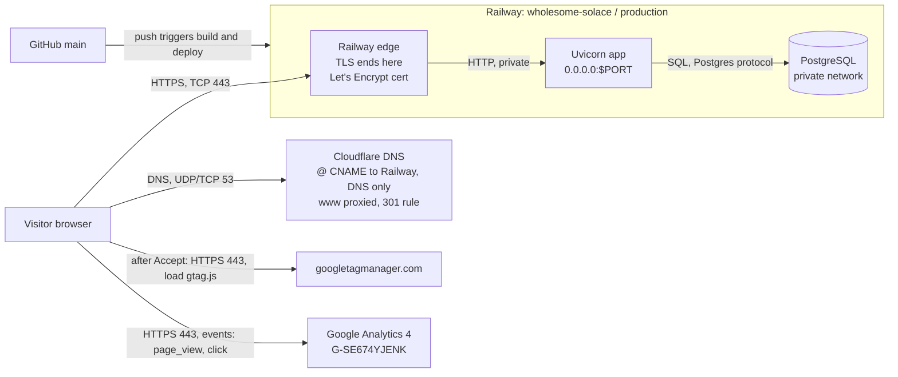
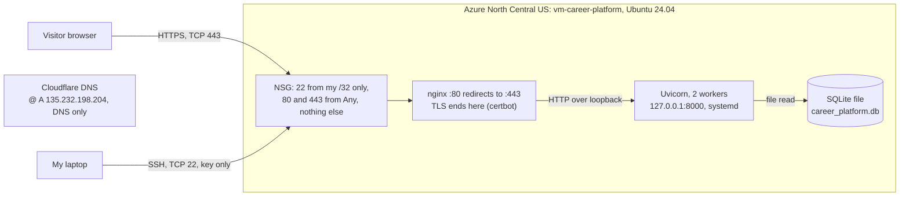
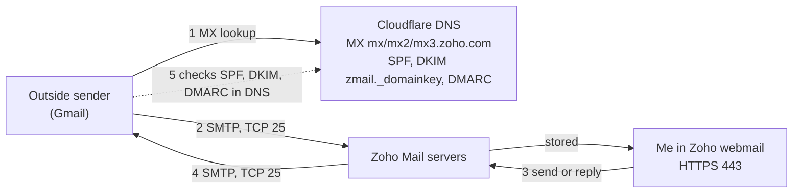

# Career Platform

My personal resume site, and the start of the career platform I'll build
this semester. It's a FastAPI app with Jinja templates and plain CSS that reads
my profile and projects from a database on every request.

**Live:** https://mjbukhadhour.com (Railway + PostgreSQL). `www` redirects to it.
**Earlier host, still running:** Azure VM `vm-career-platform` (SQLite), kept as
the rollback target until the instructor's cleanup directions.

Project 1 submission index: [`docs/project-1-submission.md`](docs/project-1-submission.md).

> **About this README.** It was written on 2026-10-25, after the work, with
> Claude Code reading the repo, Git history and saved evidence. It's a
> **retrospective** record. The plans it links to were written before each
> change. Claims link to the file, commit or check that supports them. Anything
> without proof is marked **unverified**. Today's re-run checks are in
> [`docs/evidence/project-1-checks-2026-10-25.md`](docs/evidence/project-1-checks-2026-10-25.md).

## What the site does

- Shows my name, introduction, education, experience (a labeled placeholder),
  skills and GitHub/LinkedIn links from `app/profile_content.py`, plus
  projects read from the database on every request.
- The one project entry is this website, described as a project in progress.
- Has a Privacy page, a cookie banner, and GA4 that loads only after Accept
  (commit `e7caa8c`).
- Has a contact form built for Resend. Delivery needs a Resend key, which is
  out of scope for Project 1. Whether Railway has one is **unverified**.
- `/healthz` returns `{"status":"ok"}` without touching the database.

How the database is used. The profile is in code, so it never depends on the
database. Only projects are queried, on every request:

| Situation | Status | Page | Evidence |
| --- | --- | --- | --- |
| Healthy | 200 | Profile and projects; footer `Projects source: database` | [db-failure-recovery](docs/evidence/db-failure-recovery.md), test `test_healthy_database_shows_projects_with_200` |
| Projects table empty | 200 | Profile and "No projects published yet." | same file, `test_empty_projects_table_returns_200_with_empty_message` |
| Projects query fails | 503 | Profile still shown, with "Projects temporarily unavailable". No cached or sample content | same file, `test_database_failure_keeps_profile_and_returns_503` |
| Database comes back | 200 on the next request, no restart | Projects again | same file (same process ID before and after), `test_next_request_recovers_without_restart` |

A failed query isn't remembered. Each request opens a new session. File-based
SQLite uses no connection pool, so a missing file shows up on the next
request. PostgreSQL uses `pool_pre_ping` and a 5-second connect timeout
(`app/db.py`). The earlier snapshot fallback and full-page 503 were removed,
because they hid the profile or served saved content. Verified locally
on SQLite on 2026-10-25. A PostgreSQL outage on Railway was **not** tested.

The initial database was SQLite because the course's build plan required it
([original plan](docs/superpowers/plans/2026-09-23-personal-resume-career-platform-plan.md),
line 25). The original design spec had proposed Next.js and PostgreSQL
([spec](docs/superpowers/specs/2026-09-23-personal-resume-career-platform-design.md)).
SQLite needs no server, which fit a single small VM. Railway uses PostgreSQL.

## Set up and update

### Local

```bash
uv sync                      # or: pip install -e '.[dev]'
cp .env.example .env         # local default is SQLite; never commit .env
uv run alembic upgrade head
uv run python -m app.seed    # local only, never on Railway
uv run uvicorn app.main:create_app --factory --reload --host 0.0.0.0 --port 8000
curl -fsS http://localhost:8000/healthz
uv run pytest -q             # 34 passed on 2026-10-25
```

Set `RESEND_API_KEY`,
`CONTACT_FROM` and `CONTACT_TO` in `.env` only when testing contact delivery.
Never commit `.env`, SQLite files, backups, or provider credentials.

### Railway (live)

Railway deploys `main` from GitHub automatically.
[`railway.json`](railway.json) holds the deploy config:

- pre-deploy: `alembic upgrade head`. It creates or upgrades the schema, and a failed migration fails the deploy.
- start: Uvicorn on `0.0.0.0:$PORT`, trusting Railway's forwarded headers.
- health check: `/healthz`.

`DATABASE_URL` is a Railway service variable, never in Git. The live page
reads its rows, so it points at the PostgreSQL data, but its exact setup in
the dashboard isn't recorded here.

To update: change the code, run `uv run pytest -q` and `uv run ruff check .`,
review `git diff`, commit, and push to `main`. Then check the new deployment in
Railway and the behaviour at https://mjbukhadhour.com. Railway's deployment
history is mirrored on GitHub
(`https://api.github.com/repos/mbukhadh/career-platform/deployments`).

**Docs-only commits are deployed too.** There are no watch paths in
`railway.json`, so every push to `main` redeploys, docs included: `034c890`,
`8550408`, `81403ba`, and on 2026-10-25 `8281f58`, which deployed with
success 52 seconds after the push
([checks §2 and §5](docs/evidence/project-1-checks-2026-10-25.md#5-final-push-and-railway-deployment)).
One exception: `6dd6af4` and `14df95e` (2026-10-20) have no deployment record.
The cause is **unverified**, and the commits after them deployed normally.

### Azure VM (previous host)

Set up by [`2026-09-24-azure-vm-migration.md`](docs/superpowers/plans/2026-09-24-azure-vm-migration.md)
and [`2026-10-01-operate-the-vm.md`](docs/superpowers/plans/2026-10-01-operate-the-vm.md).
HTTPS is explained in my Ex04 write-up,
[`docs/how-this-site-is-secured.md`](docs/how-this-site-is-secured.md). To update:

```bash
ssh -i ~/.ssh/isba4775_azure azureuser@135.232.198.204
cd ~/career-platform && git pull && uv sync --locked --no-dev
sudo systemctl restart career-platform && curl -s http://127.0.0.1:8000/healthz
```

## Architecture

The request path from a laptop to each host, with ports, NAT and DNS, is in
[`docs/request-path-diagram.md`](docs/request-path-diagram.md)
([Railway PNG](docs/images/request-path-railway.png),
[Azure PNG](docs/images/request-path-azure.png)). The summary below adds the
email and analytics paths.

### Railway (current)



### Azure (previous)



Public IP `135.232.198.204`, private IP `172.16.0.4`. Rules as of 2026-10-25
are in [checks §3](docs/evidence/project-1-checks-2026-10-25.md#3-azure-vm).

### Email (Zoho, same for both hosts)



Mail never touches Railway or Azure. Only DNS ties the two together.

### Analytics (GA4)

1. The page from Railway includes `static/js/consent.js`. Nothing goes to Google yet.
2. When the visitor clicks Accept, the script loads `gtag.js` from
   `www.googletagmanager.com` over HTTPS and configures `G-SE674YJENK`.
3. The browser sends events straight to Google Analytics over HTTPS:
   `page_view` on load, and `click` with `outbound: true` and `link_url` for
   links to other sites (Enhanced measurement).
4. GA4 Realtime and Tag Assistant show the events. The server never sees them.

What I checked on 2026-10-15 ([ex06 §3](docs/evidence/ex06.md#3-live-site-and-ga4)):
I loaded the live page and clicked the LinkedIn link in the header. Realtime
showed `page_view` and `click`, and Tag Assistant showed the click with
`link_domain: linkedin.com` and `outbound: true`. After adding the consent
banner, I repeated it from a private phone tab with Accept
([screenshot](docs/evidence/ga4-after-consent.png)). This shows the tag
fires on the live domain and that the interaction is attributed to the right
link. It doesn't show anything about visitor numbers.

Why the outbound click matters: the site exists to send recruiters on to my
LinkedIn, GitHub and project. A page view says someone arrived, and the
outbound click says they took the next step.

Decline deletes the `_ga` cookies (commit `e7caa8c`).

## Migration: Azure VM to Railway

The plan was written before the deployment changed:
[spec](docs/superpowers/specs/2026-10-08-railway-postgres-migration-design.md)
and [plan](docs/superpowers/plans/2026-10-08-railway-postgres-migration.md),
commit `c9f93bc` (2026-10-08). The code changes in `d4bee5f` came first.

**What Git moved:** the code, `uv.lock` (packages), the Alembic schema, and
`railway.json` (runtime and start config). **What Git didn't move:** the data
(SQLite is ignored by Git), the secrets (Railway variables), DNS (Cloudflare,
by hand), and TLS (Railway issues its own certificate).

**How the data was kept:**

1. On 2026-10-08, a consistent `.backup` of the VM's SQLite file was taken and
   copied to my laptop, outside the repo. SHA-256 matched and
   `integrity_check` returned `ok` (plan §1).
2. Railway built the schema with `alembic upgrade head`. No seed step runs on Railway.
3. `python -m app.transfer` copied every table in one transaction through
   SQLAlchemy, which converts SQLite text dates and 0/1 values to PostgreSQL
   types. The transfer's own output wasn't saved.
4. `--compare` hashed every row on both sides: all 9 tables match
   ([data comparison](docs/evidence/railway-data-comparison.md), commit
   `8550408`, 2026-10-13).

**No real data edit was made before the migration.** The VM's data was
itself created by `app/seed.py` (see [ex03](docs/evidence/ex03.md)), and no
row was changed before the transfer. So the matching comparison doesn't prove
the rows were transferred rather than reseeded. The assignment asks for one
real change first to rule that out. **That was not done.**

**Cutover:** the apex record moved from A `135.232.198.204` (recorded
2026-10-13 22:06 UTC in [dns-after-zoho](docs/evidence/dns-after-zoho.md)) to
a DNS-only CNAME to Railway. Railway's certificate was issued 2026-10-15 21:29
UTC. The exact time of the DNS change wasn't recorded. Post-cutover checks are
in [checks §1](docs/evidence/project-1-checks-2026-10-25.md#1-domain-and-https-railway).

### Who manages what

| | Azure VM | Railway |
| --- | --- | --- |
| OS and patches | Me (Ubuntu updates) | Railway |
| Runtime (Python) | Me (`uv sync` on the VM) | Railway builds it; I pin packages with `uv.lock` |
| Web entry point | Me: nginx, NSG rules | Railway edge |
| TLS certificate | Me: certbot and its timer | Railway issues and renews |
| Application code | Me | Me (push to `main`) |
| Configuration and secrets | Me: `.env` on the VM, systemd unit | Me: Railway variables, `railway.json` |
| Database software | Me (SQLite file on disk) | Railway runs PostgreSQL |
| Data and backups | Me | Me: Railway runs the server, but backups, schema changes and correctness are mine |
| DNS | Me (Cloudflare) | Me (Cloudflare) |

PaaS still leaves me the code, secrets, schema migrations, data, DNS,
costs, and noticing when something breaks. For example, Railway's Postgres
TCP proxy is still open (see limitations).

## Rollback

### Application code

1. Fastest: in Railway, open **Deployments**, pick the last good deployment
   (its commit SHA is shown, and on GitHub), and choose **Redeploy**. The site
   is back in about a minute, but `main` still has the bad code.
2. Then fix history: `git revert <bad sha>`, run the tests, and push. Railway
   deploys the revert, so Git and the live site agree again.
3. Check `https://mjbukhadhour.com/healthz` and the page.

### Database

- **Schema:** every schema change is an Alembic migration that runs in
  pre-deploy. If it fails, the deploy fails and the old version keeps serving.
  Before a risky migration, take a `pg_dump` from Railway. To undo one,
  run `alembic downgrade -1` against Railway. The only migration so far,
  `0001`, downgrades by dropping every table, so never run that one on live data.
- **Data:** the site has no write path today (no admin page; the contact form
  doesn't store anything), so live data only changes when I change it.
  Recovery sources, newest first:
  1. A `pg_dump` taken before the change.
  2. Railway's backups. Whether these exist on the trial is **unverified**.
  3. The 2026-10-08 VM backup in `~/career-platform-backups/`, loaded into an
     empty database with `python -m app.transfer`.
- Code and data roll back together when a migration is involved. Restore the
  data or downgrade first, then redeploy the matching code.

### Whole site back to Azure

1. In Cloudflare, set `@` back to an A record at `135.232.198.204`, DNS only.
2. Check `https://mjbukhadhour.com` serves the VM (`server: nginx`).
3. If Railway has taken writes since cutover, compare both databases first
   (`python -m app.transfer --compare`) and copy the newer rows back. Today
   there are none, because the app doesn't write.
4. The VM's certificate expires 2027-01-04. Certbot can't renew it while DNS
   points at Railway, so after early December, rolling back needs a manual
   `certbot` run once DNS is back on the VM.

## Decisions

### 1. How to move to Railway and PostgreSQL (2026-10-08, written before the work)

From the [migration spec](docs/superpowers/specs/2026-10-08-railway-postgres-migration-design.md#decisions):

- **Transfer script vs `pgloader` or a SQL dump.** I chose a SQLAlchemy
  transfer script with a row-hash compare. It converts types for me and proves
  the content matched. The other options needed manual boolean and date
  fixes and give no comparison.
- **psycopg 3 vs psycopg2.** I chose psycopg 3, the supported driver, and
  rewrite the URL in one place.
- **Config in `railway.json` vs the dashboard.** Keeping it in Git means the
  config is reviewed and versioned with the code.
- **Keep Azure running vs switch it off.** I kept it as the rollback target.

### 2. Managed (Zoho) vs self-hosted email (retrospective)

My in-class write-up isn't in this repo, so this is a retrospective summary
for me to check. A self-hosted mail server on the VM would need port 25
(which Azure blocks for outbound mail by default), its own spam filtering, IP
reputation, TLS, and backups. A mistake there means lost or rejected mail.
Zoho's free plan gives me a mailbox at my domain, and I only publish DNS
records (MX, SPF, DKIM, DMARC). The cost is less control and depending on a
provider's free-plan terms.

## Investigated failures

**1. Application/database dependency: the database to migrate didn't exist (real failure, 2026-09-29 to 2026-10-06).**
Written up in [`docs/evidence/ex03.md`](docs/evidence/ex03.md) §3:

- **Symptom:** `career_platform.db` was missing from the Codespace.
- **Checks:** a filesystem search for `*.db`; the `.worktrees/` timestamp; `.gitignore`.
- **Diagnosis:** the database lived in a removed worktree, and Git ignores `*.db`.
- **Repair:** rebuilt from the seed, then copied the file to the VM with `scp`.
- **Repeat check:** matching SHA-256, `integrity_check ok`, `/healthz`, and the page heading.

That file also records a second slip: a quoting error skipped the backup before `scp`.

**2. DNS/TLS: wrong A record left on the old VM (deliberate lab simulation, 2026-10-13).**
Written up in [`docs/evidence/ex05.md`](docs/evidence/ex05.md). This was the course's
supplied simulation, not my system:

- **Symptom:** curl error 60, certificate name mismatch.
- **Checks:** `dig` and `curl -Iv`.
- **Diagnosis:** DNS sent clients to the old VM.
- **Repair:** a CNAME to Railway.
- **Repeat check:** CNAME → Railway IP, certificate CN matches, HTTP/2 200.

**Also (real):** on 2026-10-16, Namecheap suspended the domain over WHOIS
verification, and DNS stopped resolving. It was fixed by verifying the
registrant email, and recovery was confirmed on 2026-10-20. See the note in
[ex06](docs/evidence/ex06.md#note-domain-suspension).

## Reflection

Assembled on 2026-10-25 from what I wrote in
[ex03 §4](docs/evidence/ex03.md#4-the-change),
[ex05 §5](docs/evidence/ex05.md#5-what-you-learned), and the Ex06 reflection
in commit `81403ba`. I still need to rewrite it in my own words.

- I understand the request path much better now. DNS failures and certificate
  failures can look the same in curl, and `openssl s_client -servername`
  against the intended IP tells them apart.
- A 200 response doesn't prove the database works, and matching row counts
  don't prove the data moved. Hashes and one real data change do.
- On a platform, I still own the data, secrets and DNS. Railway took away
  nginx, certbot and OS patches, not the responsibility.
- What I'd change: save command output as I go instead of rebuilding it
  afterward; make a real data edit before migrating; take the backup *before*
  any copy step (the ex03 slip); test the database-failure behaviour from
  the start, not at the end; and never put API keys where a
  screenshot can catch them (from the Ex06 reflection).

## Costs, credits, expiration and cleanup

| Service | What's billable | Cost / credit | Expires or renews | Cleanup |
| --- | --- | --- | --- | --- |
| Azure for Students | VM `Standard_B2ats_v2` (compute, while running); 30 GB Standard SSD (E4) and a Standard public IP (billed even when deallocated) | Paid from student credit. Amount used and credit end date **unverified**: the CLI returns no cost, so check the portal | Credit end date **unverified** | Keep running until the instructor says. Then delete resource group `rg-career-platform` (VM, disk, IP, NIC, NSG, VNet, shutdown schedule) |
| Railway | Web service and PostgreSQL usage | Trial: 30 days or $5 of usage, whichever comes first | **Trial end date unverified.** The first GitHub deployment record is 2026-10-13, and the sign-in window was Oct 3–7. Read the date from the Railway dashboard | Migrate to AWS before the trial ends. Remove the Postgres TCP proxy now. Delete the project after AWS is live |
| Domain `mjbukhadhour.com` (Namecheap) | Registration | Price **unverified** | Registered 2026-10-01, expires **2027-10-01** (WHOIS) | Renew or let lapse after the course |
| Cloudflare DNS | DNS, `www` redirect rule, edge certificate | Plan **unverified** in the dashboard (expected Free) | Edge cert valid to 2026-12-30, auto-renewed | Keep while the domain is used |
| Zoho Mail | One mailbox | Plan **unverified** in the dashboard (expected Forever Free) | none known | Keep; remove MX/SPF/DKIM/DMARC if dropped |
| Let's Encrypt | Railway cert (to 2027-01-13) and VM cert (to 2027-01-04) | Free | Railway renews its own; the VM's can't renew (see Rollback) | none |
| GA4 | Property `G-SE674YJENK` | Free | none | Delete the property if no longer used |

## Remaining limitations

- **Database failure was verified only locally on SQLite**
  ([db-failure-recovery](docs/evidence/db-failure-recovery.md)), not as a
  PostgreSQL outage on Railway.
- **No real data edit before migration.** The comparison can't tell a
  transfer from a reseed. Railway build and deploy logs from the first
  deploy weren't saved.
- **The comparison re-run failed on 2026-10-25:** `password authentication
  failed`. The Railway Postgres password changed after 2026-10-13, and the
  local `.env` still has the old one. The 2026-10-13 comparison is the latest
  successful one.
- **The Railway Postgres TCP proxy is still open** (checked 2026-10-25). It
  should be removed, as the plan says.
- **No reviewed change is documented yet** (requirement 5). See the submission index.
- **The before-MX email test isn't recorded** in [ex06](docs/evidence/ex06.md).
- **Azure restart** evidence is a stop and start read from logs afterward,
  not a planned reboot test with an outside check.
- **The VM's certificate can't auto-renew** while DNS points at Railway.
- **Email hardening:** DKIM is 1024-bit and DMARC is `p=none`, which reports
  but doesn't enforce.
- The Railway trial end date, all costs, and the Cloudflare and Zoho plans are
  **unverified** (see Costs).
