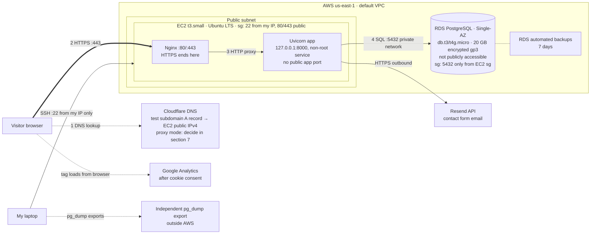

# AWS migration: Railway to EC2 + Single-AZ RDS

Working notes for the migration, following the course guide
`aws-migration.md` (Session 17, 2026-10-29). Railway keeps serving
mjbukhadhour.com until the AWS copy passes its checks.

## 1. Budget and architecture

### Account, plan and budget

Done by the account owner in the AWS console. Passwords, MFA codes and
payment details are never recorded here.

| Item | Value |
| --- | --- |
| Plan type | Free plan (confirmed on the Billing home page, 2026-11-03) |
| Credit balance | $120.00 USD (2026-11-03) |
| Credit expiration date | Apr 29, 2027 (178 days remaining as of 2026-11-03) |
| Six-month plan end date | Apr 29, 2027 |
| Budget | 1 active budget, status OK (reported by account owner, 2026-11-03) |
| MFA and sign-in work | **to confirm** |
| Access to repo, Railway database, Cloudflare zone | repo and Railway confirmed 2026-10-29; Cloudflare **to confirm** |

### Options compared

| Option | Main tradeoff |
| --- | --- |
| EC2 + local PostgreSQL | Cheapest and fastest to stand up, but I manage backups and the app and database share one failure point |
| EC2 + Single-AZ RDS | AWS runs database patching and backups, with another service to secure and additional cost |
| Lambda + API Gateway + Single-AZ RDS | No server to patch, but needs app changes (an ASGI adapter, migrations run elsewhere, the in-memory contact rate limiter breaks across instances), database connection handling, and outbound access to Resend from inside the VPC |

### Decision

> I chose **EC2 + Single-AZ RDS** over **EC2 + local PostgreSQL** because
> **I'm optimizing for learning and want AWS to run the database**, and I
> accept **another service to configure and secure, and additional cost,
> with RDS as the largest line (the guide expects about $35 a month)**.

### Checked against the guide's four requirements

| Requirement | How this plan meets it | Status |
| --- | --- | --- |
| The app runs with changes I understand | No code changes. The app already reads `DATABASE_URL`, and `app/config.py` converts `postgres://` URLs to the psycopg driver. Same uvicorn command as `railway.json`, behind Nginx, with `alembic upgrade head` run by hand. | planned |
| Data moves intact | `pg_dump` custom format from Railway (PostgreSQL 18.6), restored with `pg_restore` into RDS at the same major version or newer, then counts and records compared | planned; RDS version **to check in section 5** |
| PostgreSQL stays private | RDS **not publicly accessible**; its security group allows 5432 only from the EC2 instance's security group; no PostgreSQL on the instance | planned |
| Every service is on my plan | EC2 t3.small, encrypted gp3 EBS, one public IPv4, RDS db.t3.micro or db.t4g.micro Single-AZ with 20 GB gp3. No NAT gateway, load balancer or Multi-AZ. | **unverified**: confirm eligibility and cost in section 5 |

### Request path (target)

Planned, not built. Settings from the guide's section 5 tables.



Railway keeps serving `mjbukhadhour.com` while this is built and tested.
Production DNS changes only at section 8.

## 2. Backup and restore test

Done 2026-11-03 by Claude Code; results copied from command output.

### Backup

| | |
| --- | --- |
| Source | Railway project `wholesome-solace` (production), service `Postgres`, which backs `career-platform` on mjbukhadhour.com |
| Route | `railway connect Postgres --tunnel-only` (SSH tunnel, from [Railway's guide](https://docs.railway.com/guides/postgres-backups-restores)). No public TCP proxy was opened. |
| Tools | `pg_dump` / `pg_restore` 18.6 (Postgres.app), same version as the server (18.6) |
| Command | `pg_dump --format=custom --no-owner` |
| Backup date | **2026-11-03 18:42:16 UTC** |
| File | `~/Backups/career-platform/railway-20261103T184216Z.dump` (outside the repo, owner-only permissions) |
| Size | 21,620 bytes |
| SHA-256 | `ddcf818dfae20a4d18a9aef33bf526e2ec5af6d89dee5fead9df80be2c17b993` |
| Dump time | 9.5 s |
| Uploaded files | None to back up. The app has no upload code and writes no files; `static/` is only CSS and JS, which are in Git. |

Railway was only read from. The tunnel was closed and the temporary
credentials file deleted right after the dump. No password was printed or saved
to the repo.

### Restore test (local only, no Railway queries)

Restored into a new local database `career_platform_restore_20261103`:
`pg_restore --no-owner --no-privileges --exit-on-error`. No errors.
**Restore time: 0.05 s.**

Row counts, restored database vs. rows in the dump file itself:

| Table | Dump | Restored |
| --- | ---: | ---: |
| alembic_version | 1 | 1 |
| contact_configurations | 1 | 1 |
| education | 1 | 1 |
| experience_accomplishments | 0 | 0 |
| experiences | 1 | 1 |
| owners | 1 | 1 |
| profiles | 1 | 1 |
| projects | 1 | 1 |
| skill_groups | 1 | 1 |
| skills | 2 | 2 |

Representative records:

- Alembic version `0001_initial_schema`, the same as the repo's latest migration.
- Profile `mj-bukhadhour`, "Mohammad (MJ) Bukhadhour", published, last updated 2026-10-06.
- Project "Career Platform", `https://github.com/mbukhadh/career-platform`, published.

Restored app: run locally with `DATABASE_URL` pointed only at the restored
database. `GET /` returned 200 and showed the name, the Career Platform project
and footer `Projects source: database`.

Nothing failed to match.

### Copies

| Copy | Where | Status |
| --- | --- | --- |
| 1 | `~/Backups/career-platform/` on this Mac, outside the repo | done |
| 2 | LMU OneDrive, `OneDrive-lmu.edu/Backups/career-platform/` (dump plus `.sha256` file), not password-protected | done 2026-11-03; SHA-256 of the copy matches `ddcf818d…c17b993` |

Both dumps are kept on this Mac: `railway-20261029T222355Z.dump` (first
backup) and `railway-20261103T184216Z.dump` (this one). The 10/29 test
database `restore_test` was dropped.

### Frequency, retention, RPO and RTO (accepted 2026-11-03)

| | Proposal | Why |
| --- | --- | --- |
| Backup frequency | Manual `pg_dump` weekly, plus before any content change and before cutover | Content changes rarely and only by hand |
| Retention | Keep the last 4 weekly dumps plus the final pre-cutover dump until the course ends | Small files (about 21 KB) |
| RPO (acceptable data loss) | 1 week, with zero loss at cutover (final backup after pausing writes) | Only my own edits would be lost |
| RTO (recovery time) | 1 hour | Restore itself takes under a second; the time is in setup and checks |
| After the move | RDS automated backups, 7 days, plus an independent `pg_dump` export kept outside AWS | Section 5 setting, as the guide asks |

### Railway access left in place

The SSH key `mac-railway-cli` (fingerprint
`SHA256:U4JoTMMo6ysQLTtioyjtYF9NAyWGrgIfB8cBOOzmhe0`) is still registered on
the Railway account; the tunnel needs it. To remove it:
`railway ssh keys remove SHA256:U4JoTMMo6ysQLTtioyjtYF9NAyWGrgIfB8cBOOzmhe0`
(add `--2fa-code <code>` if Railway 2FA is on). Not removed yet. After removing it,
`railway connect --tunnel-only` stops working until a key is registered again.

## 4. AWS CLI connection

Done 2026-11-03. No access keys were created, and no credential files were read.

### AWS CLI install

| | |
| --- | --- |
| Version | `aws-cli/2.39.3` (guide requires 2.35.0 or later) |
| Package | Official `AWSCLIV2.pkg` from `awscli.amazonaws.com`, signed by "Developer ID Installer: AMZN Mobile LLC" and notarized by Apple |
| Install type | Current user only (AWS's documented per-user install), into `~/aws-cli`, linked into `~/.local/bin`. No admin password needed. |

### Sign-in

`aws login --profile isba-4775 --region us-east-1`, then
`aws configure set region us-east-1 --profile isba-4775`.

- **First attempt signed in as root.** The browser was still signed in as the
  account owner, so the profile pointed at
  `arn:aws:iam::355258598994:root`. Per the guide, it was not used.
  `aws logout --profile isba-4775` cleared it.
- **Second attempt** signed in as the IAM user in the browser. The CLI asked
  whether to replace the old root session, and `!` can't answer prompts, so it
  stopped with `EOF`. Rerun with `echo y | aws login ...`, which updated the
  profile to the IAM user.

### Connection check (read-only)

| Check | Result |
| --- | --- |
| `aws sts get-caller-identity --profile isba-4775` | Account `355258598994`, ARN `arn:aws:iam::355258598994:user/isba-student` (not `:root`) |
| Profile region | `us-east-1` |
| `aws ec2 describe-instances` in us-east-1 | Succeeded, no instances (expected) |
| RDS and IAM access | Not probed. Access denied is expected until section 5 adds deployment permissions. |

### Agent toolkit

`aws configure agent-toolkit --yes`, the same as answering Y to both questions.

- 25 AWS skills installed for Claude Code (`~/.claude/skills`) and Codex
  (`~/.agents/skills/`). The guide says 24; this CLI version installs 25.
- AWS MCP server added to Claude Code (`~/.claude.json`). It was not set up for
  Codex, because `codex` isn't on PATH.
- **To do:** restart Claude Code so it loads the MCP server.

Repeat `aws login --profile isba-4775` when the session expires. To clear the
cached session when finished: `aws logout --profile isba-4775`.

## 5. Plan: EC2 + Single-AZ RDS (EC2 and RDS created 2026-11-05)

Planned 2026-11-03 on branch `aws-migration`. Railway deploys only from `main`
(latest deploy: `main` at `c3e1fea`, status SUCCESS), so this branch doesn't
trigger a redeploy. **Don't push to `main` and don't open a PR** until cutover,
in case Railway preview environments are on (not checked).

### What the account has now (read-only check, us-east-1)

| Item | Found |
| --- | --- |
| Default VPC | `vpc-09d0c5d1fc7afae21`, 172.31.0.0/16 |
| Default subnets | One in each of us-east-1a to 1f, all assign public IPs |
| Security groups | Only `default` |
| Instances, volumes, Elastic IPs, key pairs | None |
| t3.small | 2 vCPU, 2 GiB, `FreeTierEligible: true` |
| Ubuntu 24.04 LTS x86_64 AMI (Canonical) | Latest `ami-0d6dd9e8265d48906` (2026-10-23). Re-check at launch. |
| RDS PostgreSQL 18.6 | Supported, per the [RDS release notes](https://docs.aws.amazon.com/AmazonRDS/latest/PostgreSQLReleaseNotes/postgresql-versions.html) |
| RDS, EBS default encryption | Access denied before the policy was attached. RDS is readable now, see "RDS checks" below. EBS default encryption is still not readable, because the policy doesn't include it. |

The account holds no other work, so the deployment policy's region-wide
scope doesn't touch anything unrelated.

### EC2 (guide's section 5 settings)

| Setting | Plan |
| --- | --- |
| Image and compute | Ubuntu LTS x86_64 (Canonical), one t3.small, On-Demand, **Standard** CPU credits. Planned as 24.04. Launched on **26.04 LTS**, the console's current default, which the owner approved. |
| Storage and metadata | 16 GB gp3, encrypted; IMDSv2 required |
| Network | Default VPC, default subnet in **us-east-1a**, one automatic public IPv4 |
| Security group `career-platform-web` | 22 from my current IP `/32` only; 80 and 443 from anywhere |
| SSH | New key pair `career-platform-ec2`. Private key in `~/.ssh` with mode 600, never in Git. Before the first connect, check the host key fingerprint against the instance's console output. |
| Private services | Uvicorn on `127.0.0.1:8000` only. No PostgreSQL on the instance. |

### RDS (guide's section 5 settings)

| Setting | Plan |
| --- | --- |
| Engine | PostgreSQL 18.6, same as Railway |
| Class and availability | db.t4g.micro (or db.t3.micro), Single-AZ, in **us-east-1a** to sit with EC2 and avoid cross-AZ transfer |
| Storage | 20 GB gp3, encrypted, autoscaling off |
| Database name | `career_platform` |
| Credentials | Self-managed. A generated password goes into a local mode-600 file and into the create call through the AWS CLI, so it never appears in chat or tool output. It's then written to the server's env file and the local file is deleted. |
| Network | Default VPC, **Publicly accessible: No**. Security group `career-platform-db` allows 5432 only from `career-platform-web`. A new DB subnet group `career-platform-db` from the default subnets in us-east-1a and 1b; RDS needs two AZs even for Single-AZ, and none exists yet. Database placed in us-east-1a. |
| Backups | Planned: automated, 7 days. **Created with 1 day**, because the Free plan refused 2 to 7 (see "RDS creation"). The independent `pg_dump` exports outside AWS (section 2) stay the main safety net. |

### On the server (section 6)

This is the plan as written. What was actually done, and how it differed, is
in "6. Deploy and restore" at the end of this doc.

- Packages: `nginx`, `git`, and `postgresql-client-18` from the PostgreSQL
  apt repository. Ubuntu 24.04's own client is 16, too old to restore an 18
  dump. Python through `uv sync` with the repo's `uv.lock` (needs Python 3.12 or newer).
- A non-root system user `career` owns `/srv/career-platform`, checked out at
  the intended commit of `aws-migration`.
- Env file `/etc/career-platform/env`, mode 600, outside the repo:
  `DATABASE_URL=postgresql://…@<rds-endpoint>:5432/career_platform?sslmode=require`,
  `RESEND_API_KEY`, `CONTACT_FROM`, `CONTACT_TO`, `ENVIRONMENT=production`.
  Values are copied from Railway's variables without being printed.
- systemd service `career-platform`: `User=career`, runs
  `uvicorn app.main:create_app --factory --host 127.0.0.1 --port 8000 --proxy-headers --forwarded-allow-ips=127.0.0.1`,
  `Restart=on-failure`, enabled at boot. Railway trusts `*` for forwarded
  headers, but here only local Nginx should be trusted.
- Nginx: a site for the test subdomain that proxies to `127.0.0.1:8000` and
  sets `Host`, `X-Forwarded-For` and `X-Forwarded-Proto`. Enabled at boot.

### How the plan handles each concern

| Concern | Plan |
| --- | --- |
| Data | Copy the latest dump to EC2 with `scp`, then `pg_restore --no-owner --no-privileges --exit-on-error` into the new RDS database **from EC2**, since RDS isn't reachable from the laptop. Compare row counts and records with the backup. The dump carries `alembic_version` = `0001_initial_schema`, so `alembic upgrade head` should do nothing. **Never run `app.seed`.** |
| Uploads | None. The app has no upload feature and writes no files. Static CSS and JS come from Git. |
| Secrets | RDS password, Resend key and env values only in the server env file (mode 600). Never in chat, Git or command output. SSH private key in `~/.ssh`. `.env` is already gitignored. |
| HTTPS | Section 7: a separate Cloudflare A record for a test subdomain, with a certificate from the course HTTPS guide. If proxied, Full (strict) with a valid origin certificate. Production DNS is unchanged. |
| Testing | Section 7 list: deployed commit, records against backup, a target-only record surviving a restart, a reboot test, pages, redirects, assets, contact form, certificate renewal, SSH restriction, RDS not public, and actual costs. |
| Rollback | Railway keeps serving mjbukhadhour.com and stays the source of truth. Until cutover, rollback means deleting the test DNS record and the AWS resources. After cutover, rollback means pointing DNS back at Railway, reconciling any records written on AWS first. |

### Code changes

None needed. The app already reads its settings from the environment, and
`app/config.py` rewrites `postgresql://` to the psycopg driver. The Nginx and
systemd config will be added to this branch as files for review before use.

### Next, from the guide

1. ~~Estimate the monthly cost~~ Done, see below.
2. ~~Review the `ISBA4775EC2Migration` deployment policy~~ Done and attached, see below.
3. Review the EC2 and RDS settings in the console, approve, then create each once. EC2 launched and RDS created 2026-11-05, see "EC2 launch" and "RDS creation" below.

### Cost estimate (us-east-1, On-Demand)

Prices come from AWS's public Price List offer files for us-east-1, fetched
2026-11-03: EC2 published 2026-11-03, VPC 2026-11-03, Data Transfer
2026-11-03, RDS 2026-10-29. The Price List API itself was denied to
`isba-student`. A month is counted as 730 hours.

| Line item | Price | Monthly |
| --- | --- | ---: |
| EC2 t3.small, Linux | $0.0208 per hour | $15.18 |
| EBS gp3, 16 GB (baseline 3,000 IOPS / 125 MB/s included) | $0.08 per GB-month | $1.28 |
| Public IPv4, 1 in-use address | $0.005 per hour | $3.65 |
| RDS db.t4g.micro PostgreSQL, Single-AZ | $0.016 per hour | $11.68 |
| RDS gp3 storage, 20 GB Single-AZ | $0.115 per GB-month | $2.30 |
| RDS automated backups, 7 days | $0.095 per GB-month only above the free allocation | $0.00 |
| Data transfer EC2 to RDS, same AZ (us-east-1a) | Free in the same AZ; $0.01 per GB each way across AZs | $0.00 |
| Data transfer out to the internet | $0.09 per GB beyond the global free tier | $0.00 |
| **Total** | | **$34.09** |

With db.t3.micro instead ($0.018 per hour) the total is **$35.55**.

Assumptions behind the $0 lines:

- Backups: the database is about 8 MB, far below the free backup allocation.
  RDS gives free backup storage up to the provisioned storage size (20 GB).
  That allocation comes from AWS's RDS pricing terms, not the price file.
- Internet egress: a personal site sends well under 1 GB a month, inside the
  free tier.
- EC2 and RDS stay in the same AZ.
- EC2 uses Standard CPU credits, so no surplus credit charges. RDS t4g/t3
  instances run in unlimited mode, so a sustained CPU spike could add a small
  charge. Not expected at this load.

Not included: tax, EBS or RDS snapshots beyond the automated backups, Elastic
IPs (section 8), and anything left running after the course.

The guide expects about $35 with RDS as the largest line. The total matches.
EC2 alone ($15.18) is the largest single line, while RDS instance plus storage
comes to $13.98.

### Against credits and budget

| | |
| --- | --- |
| Credits | $120.00, expiring Apr 29, 2027 |
| Burn rate | About $1.12 a day, $34.09 a month |
| Credits last | About 3.5 months (about 107 days) if everything runs from 2026-11-03, so they run out around **2027-02-18**, before the Apr 29 expiry |
| Through an assumed course end of 2026-12-15 | About $47, leaving about $73 |
| Budget | Zero spend budget. It emails on the first charge not covered by credits. It is an alert, not a cap. |

The plan fits the credits for the rest of the semester but not the full six
months, the same as the guide says. Delete the EC2 instance, its volume and
the RDS database (with a final snapshot) when the course ends. Watch the
Credits page, since the Zero spend budget only reacts once credits stop
covering a charge.

**Unverified:** that each line here is covered by Free plan credits. EC2
reports t3.small as `FreeTierEligible: true`. RDS Free plan eligibility is
still unverified. The deployment policy's limits are reviewed below.

### Deployment policy review: `ISBA4775EC2Migration`

Reviewed 2026-11-03 from the course copy at
`guides/aws-ec2-deployment-policy.json`, SHA-256
`af41366bad568ee7ae87742b2379d62aa373cc8df3922afd1a83db6f81815076`.
**Attached to `isba-student` in the console by the account owner on
2026-11-03** (owner-confirmed). The RDS calls below succeeded afterwards.

**Allows (us-east-1 only):**

- EC2: describe, console output, launch, tag, import and delete key pairs, security
  groups and their rules, credit mode, start, stop, reboot and terminate, Elastic
  IPs, delete volumes.
- RDS: describe and tag, create, modify, start, stop, reboot and delete instances,
  subnet groups, snapshots, restore.
- Creating the RDS service-linked role, looking up Canonical's Ubuntu image
  parameters in SSM, and decoding denial messages.

**Blocks:**

- EC2 types other than t3.micro and t3.small.
- Launches without IMDSv2 required.
- RDS classes other than db.t3.micro and db.t4g.micro.
- Multi-AZ, more than 20 GB of storage, unencrypted databases, and publicly
  accessible databases, both at create and through a later change.
- Anything outside us-east-1, and anything not listed: no VPC, subnet, NAT,
  load balancer, IAM role or Secrets Manager changes.

**Not enforced, so the plan sets each one explicitly:**

| Gap | Risk | Plan setting |
| --- | --- | --- |
| T3 credit mode | t3 defaults to Unlimited, which can bill surplus CPU | `CpuCredits=standard` at launch |
| EBS size, type, encryption | Nothing stops a large or unencrypted volume | 16 GB gp3, `Encrypted=true`, delete on termination |
| RDS storage autoscaling | The 20 GB limit checks allocated size only | No `MaxAllocatedStorage` (autoscaling off) |
| RDS storage type and IOPS | Provisioned-IOPS storage is allowed | `gp3` |
| Backup retention | Could be 0, which turns backups off | 7 days |
| Final snapshot on delete | Deletion without a snapshot is allowed | Always take a final snapshot (section 8) |
| Number of instances, databases, Elastic IPs | No limit and no budget cap | One of each; Zero spend budget as the alert |
| Scope | Can stop or delete any EC2 or RDS resource in us-east-1 | Acceptable: the account has no other resources (checked 2026-11-03). Ask for it to be narrowed if other work is added. |

**Side effects:** volumes can't be resized (no `ec2:ModifyVolume`), so a
bigger disk means a new instance. Instance roles can't be attached (no
`iam:PassRole`), so admin access is SSH only. Nothing blocks the plan.

### RDS checks (read-only, after the policy)

| Check | Result |
| --- | --- |
| Identity | `arn:aws:iam::355258598994:user/isba-student` |
| PostgreSQL 18 versions on RDS | 18.1, 18.2, 18.3, 18.4, **18.6**; parameter family `postgres18` |
| 18.6 orderable, gp3 | db.t4g.micro and db.t3.micro in us-east-1a, 1b, 1c, 1d and 1f (not 1e) |
| Existing DB instances | None |
| Existing DB subnet groups | None, so the plan creates one |
| EBS encryption by default | Still access denied, because the policy doesn't include it. Not needed, since the plan sets `Encrypted=true`. |

### EC2 launch review (console walkthrough, 2026-11-05, nothing created)

These are the values to check under **EC2 → US East (N. Virginia) → Launch
instance**, in the order the page shows them. During the review, don't click
**Create new key pair**, because it creates the key right away. End the review
with **Cancel**, not **Launch instance**.

| Wizard section | Value to check | Why it matters |
| --- | --- | --- |
| Name and tags | `career-platform-web` | Identifies the instance |
| Application and OS Images | Ubuntu Server 24.04 LTS (HVM), SSD Volume Type, 64-bit (x86), Canonical, "Free tier eligible". Latest seen: `ami-0d6dd9e8265d48906` (2026-10-23). Re-check right before launch. | t3 is x86 only |
| Instance type | t3.small (2 vCPU, 2 GiB) | Policy allows only t3.micro and t3.small |
| Key pair | New `career-platform-ec2`, created at launch. Private key goes in `~/.ssh` with mode 600, never in Git. | SSH access |
| Network: VPC and subnet | Default VPC `vpc-09d0c5d1fc7afae21`, subnet `subnet-08d9e31f030d60875` (us-east-1a) | Same zone as RDS, so no cross-AZ transfer cost |
| Network: public IP | Auto-assign public IP: Enable (one IPv4, about $3.65 a month) | Internet access and DNS target |
| Firewall | Create security group `career-platform-web`: SSH 22 from **My IP** (/32) only, which is not the console's Anywhere default. HTTP 80 and HTTPS 443 from Anywhere. | Restricted SSH, public web |
| Not opened | Port 8000 (Uvicorn listens on `127.0.0.1`) and port 5432 (no PostgreSQL on the instance) | No public app-server or database port |
| Storage (Advanced) | 16 GiB (the default is 8), gp3, **Encrypted** with `aws/ebs`, delete on termination | The policy doesn't enforce encryption and can't resize later |
| Credit specification | **Standard** | t3 defaults to Unlimited, which can bill surplus CPU |
| Metadata | Accessible: Enabled. Version: **V2 only (token required)** | The policy rejects launches without IMDSv2 |
| IAM instance profile | None | No `iam:PassRole`, so admin access is SSH only |
| User data | Empty | Setup is done over SSH in section 6 |
| Summary | 1 instance, t3.small, 16 GiB volume | Exactly one of each |

**Still to do before launch:**

- Look up my current public IP for the SSH rule.
- Re-check the latest Canonical AMI.
- Reconnect the aws-mcp server, which failed to connect on 2026-11-05.

**After launch:**

- In the console, verify the instance ID, public address, security group, and the encrypted 16 GiB gp3 volume.
- Before the first SSH connection, compare the host key fingerprint with the instance's console output.

**Status:** the owner reviewed the console form as `isba-student` in N. Virginia, cancelled it, and approved on 2026-11-05. Launched once, see "EC2 launch" below.

### EC2 launch (2026-11-05)

Launched once by the agent with the AWS CLI (profile `isba-4775`, identity
`arn:aws:iam::355258598994:user/isba-student`), after the owner's approval.
The aws-mcp server was disconnected, so the CLI was used instead. A
`--dry-run` passed before the real launch.

| Item | Result |
| --- | --- |
| Instance | `i-04af2fcbbe7761894`, tags `Name=career-platform-web`, `Project=career-platform` |
| Launched | 2026-11-05 21:05:23 UTC, running |
| Image | `ami-0547ecbf0e9b4aeb5`, `ubuntu-resolute-26.04-amd64-server-20261104.1`, owner `099720109477` (Canonical), x86_64. Found through the SSM parameter `/aws/service/canonical/ubuntu/server/26.04/stable/current/amd64/hvm/ebs-gp3/ami-id`. |
| Type and credits | t3.small (`FreeTierEligible: true`), On-Demand, CPU credits `standard` (verified after launch) |
| Network | Default VPC `vpc-09d0c5d1fc7afae21`, subnet `subnet-08d9e31f030d60875` (us-east-1a). Public IPv4 `44.205.6.55` (automatic, can change after a stop and start). Private IP `172.31.13.191`. |
| Security group | `sg-03be56c4763bfb09b` (`career-platform-web`): 22/tcp from `104.174.111.150/32`, 80/tcp and 443/tcp from `0.0.0.0/0`. Nothing else. |
| Root volume | `vol-0269f675e7af1472e`, 16 GiB gp3, encrypted with the AWS-managed `aws/ebs` key, delete on termination. The image's default (8 GiB, unencrypted) was overridden. |
| Metadata | IMDSv2 required, endpoint enabled, hop limit 2 |
| IAM profile, user data | None |
| Key pair | `career-platform-ec2` (`key-08a300ef4f72109c3`), ed25519. Generated on the Mac at `~/.ssh/career-platform-ec2` (mode 600), outside Git. Only the public key was imported, so the private key never left the Mac. Fingerprint `SHA256:o/qxDag3U/2LVfLCGM0rdXttA3XPZiDYyGh/IK7Th1g`. |
| Account after launch | One instance, one volume, the new security group plus `default`, one key pair, no Elastic IPs |

**Host identity check:** before the first connection, the fingerprints from
`ssh-keyscan` were compared with the cloud-init block in
`get-console-output`. All three matched, and only then were the keys added to
`~/.ssh/known_hosts`. The first connection used `StrictHostKeyChecking=yes`.

| Key | Fingerprint (console = network) |
| --- | --- |
| ED25519 | `SHA256:VCi9Aum4bHSn9qeaPVEBVQJCO00QEnrpmtmAfWAvsm4` |
| ECDSA | `SHA256:BPi0nl1K/IefFQEOkud5nyP1WITB1UMV7PJrytVyVCo` |
| RSA | `SHA256:aOJ5xpxzffbsLi4jKeMQlQwzKASzQMfJYZe1WxWanvk` |

**First SSH login (read-only):**

- User `ubuntu`.
- Ubuntu 26.04.1 LTS, x86_64.
- Root disk 15G, 2.1G used.
- `cloud-init status: done`.
- Python 3.14.4, which meets the app's 3.12+ requirement.

**Follow-ups:**

- **Section 6:** confirm how to install `postgresql-client-18` on 26.04. The plan's note about Ubuntu's own client was written for 24.04. Resolved in section 6: Ubuntu 26.04 ships 18.6.
- **If the owner's IP changes:** update the port 22 rule.
- **Section 8:** before cutover, settle on a stable address.
- **Cost:** about $15.18 a month for the instance, plus $1.28 for the disk and $3.65 for the IPv4 address, from 2026-11-05.

### RDS creation (2026-11-05)

Console review: the owner reviewed the Create database form as `isba-student`.
**Free tier was not offered** (only Production, Dev/Test, Sandbox), so the
Dev/Test settings were used. The owner approved `career_admin` and deletion
protection on. The agent created each item once with the AWS CLI (profile
`isba-4775`).

**Security group `career-platform-db`** (`sg-072e3ecea3887bc05`, default VPC):
one inbound rule, 5432/tcp from `sg-03be56c4763bfb09b` (`career-platform-web`)
only. No IP ranges.

**DB subnet group `career-platform-db`:** `subnet-08d9e31f030d60875`
(us-east-1a) and `subnet-098a022239ed5253a` (us-east-1b). Status Complete.

**Password:** 48 hex characters from `openssl rand`, written to
`~/.config/career-platform/rds-master-password` (mode 600, folder mode 700,
outside the repo). It reached AWS through a temporary mode-600
`--cli-input-json` file, which was deleted after each call. It was never
printed. It still has to go into the server's env file in section 6, and the
local copy will be deleted after that.

**Backup retention, a deviation from the plan:**

| Attempt | Result |
| --- | --- |
| 7 days (plan) | Refused: `FreeTierRestrictionError: The specified backup retention period exceeds the maximum available to free tier customers.` |
| 6, 5, 4, 3, 2 | Same refusal. Nothing was created. |
| **1 day** | **Accepted.** This was the first value accepted, and it was used. |

The console dropdown lists 1 to 35 and doesn't show this limit. The guide asks
for seven days, but the Free plan allows only one day of automated backups and
point-in-time recovery. Upgrading the plan is against the guide, so 1 day was
accepted. The **weekly `pg_dump` copies on the Mac and OneDrive (section 2)
stay the main safety net**, plus a fresh dump before cutover and a final
snapshot on deletion.

**Database `career-platform-db`, verified once available:**

| Check | Result |
| --- | --- |
| Status | `available`, created 2026-11-05 21:28:51 UTC. Only DB instance in the account. |
| Endpoint | `career-platform-db.cancycewkh75.us-east-1.rds.amazonaws.com:5432`, resolves to private `172.31.3.22` |
| Engine | PostgreSQL 18.6, parameter group `default.postgres18` |
| Class | **db.t4g.micro** |
| Availability | **Single-AZ** (`MultiAZ: false`), in us-east-1a, the same zone as EC2 |
| Publicly accessible | **No** (`PubliclyAccessible: false`) |
| Storage | 20 GiB gp3 (3,000 IOPS, 125 MiB/s), encrypted with the AWS-managed `aws/rds` key, autoscaling off (`MaxAllocatedStorage` not set) |
| Database / user | `career_platform` / `career_admin`, self-managed password (no Secrets Manager secret) |
| Network | Subnet group `career-platform-db`, security group `sg-072e3ecea3887bc05` active |
| Backups | Automated, **1 day**, copy tags to snapshots on |
| Monitoring | Enhanced Monitoring off (interval 0), Performance Insights off |
| Other | Deletion protection on, auto minor version upgrade on |

**Cost:** about $11.68 a month for the instance plus $2.30 for storage, from
2026-11-05.

**Still to do (section 6):**

- From EC2, check that the database answers over TLS.
- Write `DATABASE_URL` into `/etc/career-platform/env` without printing it.
- Delete the local password file.
- Restore the backup from EC2.
- Turn deletion protection off only right before the planned delete with a final snapshot (section 8).

## 6. Deploy and restore (2026-11-05)

The owner approved four decisions:

- move the SSH rule to the new IP
- use Ubuntu's own `postgresql-client-18`
- restore the verified Nov 3 dump now and take a fresh dump before cutover (section 8)
- keep `--workers 2`

The agent ran the phases in order, over SSH as `ubuntu` with host key
checking on. Each phase's check passed before the next one started. Railway
was only read. Production DNS was not touched, and the seed script was never
run.

### Phase 0: SSH access

SSH timed out because the owner's public IP had changed from `104.174.111.150`
to `157.242.208.93`. In `sg-03be56c4763bfb09b` the agent added
`157.242.208.93/32` on port 22 and then removed `104.174.111.150/32`. The
inbound rules are now only 22 from `157.242.208.93/32`, plus 80 and 443 from
anywhere. SSH works again.

### Phase 1: packages

`apt upgrade` ran, and no reboot was needed (kernel `7.0.0-1016-aws`). Then
these were installed:

| Package | Version | Source |
| --- | --- | --- |
| `postgresql-client-18` (`psql`, `pg_restore`) | 18.6-0ubuntu0.26.04.1 | Ubuntu `resolute-updates` and `resolute-security`. This replaces the planned PostgreSQL apt repository, which was only needed on 24.04. |
| nginx | 1.28.3-2ubuntu1.12 | Ubuntu |
| git | 2.53.0 | Ubuntu |
| uv | 0.13.7 | Astral installer, put in `/usr/local/bin` |
| Python | 3.14.4 | Ubuntu, already installed. The app needs 3.12 or newer. |

Installing nginx briefly served its default welcome page on port 80. Phase 6
removed it.

### Phase 2: app user and code

- **User:** system user `career`, uid 999, home `/srv/career-platform`, shell
  `/usr/sbin/nologin`.
- **Code:** the public repo `mbukhadh/career-platform` was cloned to
  `/srv/career-platform` and checked out at
  `c3e1fea283cd401cf4bd3d4ff6487cae41a4c863`. That's the same commit as `main`
  and `aws-migration`, which Railway runs. The checkout has no local changes.
- **Dependencies:** `uv sync --frozen --no-dev` installed them from `uv.lock`
  (uvicorn 0.54.0, psycopg 3.3.6). The app imports cleanly.

### Phase 3: environment file and database link

**Railway check, which differed from the plan:** the `career-platform`
production service has only `DATABASE_URL` plus Railway's own `RAILWAY_*`
variables. `RESEND_API_KEY`, `CONTACT_FROM`, `CONTACT_TO` and `ENVIRONMENT`
are not set. Only the variable names were read, never the values. Production
therefore runs on the app's defaults, which means the contact form can't send
email. `ENVIRONMENT` isn't read by any code.

**Guide check:** section 6 names only the database URL, and section 5 says the
RDS password goes into the server's environment file. Nothing in the guide
mentions the contact form or Resend. The owner chose **option 1, a
`DATABASE_URL`-only env file**, so AWS behaves like Railway. Adding a Resend
key would be a separate change.

**Incident:** the first write attempt sent empty input after the Railway check
failed. That left a 0-byte `/etc/career-platform/env` (root, mode 600). No
secret was written or printed. The final write goes to a temporary file first,
refuses empty input, and then moves it into place.

| Check | Result |
| --- | --- |
| Env file | `/etc/career-platform/env`, `root:root`, mode 600, 187 bytes, one line: `DATABASE_URL="postgresql://career_admin:…@career-platform-db.cancycewkh75.us-east-1.rds.amazonaws.com:5432/career_platform?sslmode=require"` |
| Connection from EC2 | `career_admin` to `career_platform` on PostgreSQL 18.6, at server address `172.31.3.22` (private) |
| TLS | `ssl=true`, TLSv1.3, `TLS_AES_256_GCM_SHA384` |
| Before restore | 0 tables in `public` |
| Local password copy | `~/.config/career-platform/rds-master-password` and its folder were deleted. The server's env file is now the only copy. If it's lost, reset the password with `modify-db-instance`. |

### Phase 4: restore

- **Dump:** `~/Backups/career-platform/railway-20261103T184216Z.dump` was
  copied to EC2 with `scp`, into a mode-700 folder. Its SHA-256 on the server
  matched `ddcf818dfae20a4d18a9aef33bf526e2ec5af6d89dee5fead9df80be2c17b993`.
- **Restore:** `pg_restore -d <DATABASE_URL> --no-owner --no-privileges --exit-on-error`
  restored 10 `TABLE DATA` entries with **no errors in 0.19 s**.
- **Cleanup:** the dump copy was then deleted from EC2.

| Table | Section 2 | RDS |
| --- | ---: | ---: |
| alembic_version | 1 | 1 |
| contact_configurations | 1 | 1 |
| education | 1 | 1 |
| experience_accomplishments | 0 | 0 |
| experiences | 1 | 1 |
| owners | 1 | 1 |
| profiles | 1 | 1 |
| projects | 1 | 1 |
| skill_groups | 1 | 1 |
| skills | 2 | 2 |

**Records checked:**

- Profile `mj-bukhadhour`, "Mohammad (MJ) Bukhadhour", published, updated 2026-10-06.
- Project "Career Platform", `https://github.com/mbukhadh/career-platform`, published.

**Alembic:** `alembic current` showed `0001_initial_schema (head)`.
`alembic upgrade head` ran as `career` with exit 0 and changed nothing.

**Uploads:** none to restore.

### Phase 5: app service

The unit `deploy/career-platform.service` was installed as
`/etc/systemd/system/career-platform.service`:

- `User=career`
- `WorkingDirectory=/srv/career-platform`
- `EnvironmentFile=/etc/career-platform/env`
- `ExecStart=.venv/bin/uvicorn app.main:create_app --factory --host 127.0.0.1 --port 8000 --workers 2 --proxy-headers --forwarded-allow-ips=127.0.0.1`
- `Restart=on-failure`, `NoNewPrivileges`, `PrivateTmp`

It was turned on with `systemctl enable --now`.

| Check | Result |
| --- | --- |
| `systemctl is-enabled` / `is-active` | enabled / active |
| `ps -u career` | Main process plus Python's resource tracker and **two workers**, all owned by `career`. No Uvicorn process runs as root. |
| Listening | `127.0.0.1:8000` only |
| `curl http://127.0.0.1:8000/healthz` and `/` | 200 and 200. The page shows the name and `Projects source: database`. |
| `journalctl -u career-platform` | Clean start: both workers reached "Application startup complete" |

With two workers, the contact form's in-memory rate limiter counts per worker,
so the effective limit doubles. The owner accepted this.

### Phase 6: Nginx

The site `deploy/nginx-career-platform.conf` was installed as
`/etc/nginx/sites-available/career-platform` and linked into `sites-enabled`.
It listens on port 80 as `default_server` and proxies to
`http://127.0.0.1:8000`, setting `Host`, `X-Real-IP`, `X-Forwarded-For` and
`X-Forwarded-Proto`. The default site was removed. `nginx -t` passed, Nginx
was reloaded, and it's enabled at boot.

| Check | Result |
| --- | --- |
| Sites enabled | `career-platform` only |
| Processes | master as `root`, workers as `www-data` |
| `curl -I http://localhost` | `Server: nginx/1.28.3 (Ubuntu)`, 405. The app has no HEAD handler for `/`, and production `mjbukhadhour.com` also returns 405. |
| `GET /` from the laptop, `http://44.205.6.55/` | 200, `Projects source: database` |
| Assets from the laptop | `/static/css/site.css` 200 `text/css`, `/static/js/consent.js` 200 `text/javascript`. Page links use the forwarded host. |
| Port 8000 from the laptop | Unreachable (timeout) |
| Listening sockets | 22, 80 (public), 8000 on `127.0.0.1` only, local DNS |

### Phase 7: reboot test

`sudo systemctl reboot` at 22:06:31 UTC. The server was back at 22:06:42.

| Check | Result |
| --- | --- |
| `career-platform` | enabled / active. Started at 22:06:50 with no login; both workers reached startup complete by 22:06:55. |
| nginx | enabled / active |
| Site from the laptop | 200, name shown, `Projects source: database` |
| Public IP | Still `44.205.6.55`. A reboot keeps it, but a stop and start may not (section 8). |

### Files added to this branch (uncommitted)

- `deploy/career-platform.service`
- `deploy/nginx-career-platform.conf`

### Left for later sections

- **Section 7:**
  - test subdomain DNS record
  - HTTPS on port 443, with the server name added to the Nginx site
  - the full verification list
- **Section 8:**
  - fresh `pg_dump` from Railway and restore before cutover
  - stable address decision
- **Contact form:** not configured on Railway or AWS. Adding a Resend key is a
  separate owner decision.
- **SSH rule:** update it whenever the owner's IP changes.

## 7. Verify on a test subdomain (2026-11-05)

The owner approved five choices:

- the test name `aws.mjbukhadhour.com`
- DNS only (gray cloud)
- the owner runs the two Certbot commands in their own SSH session, answering Let's Encrypt's email and terms prompts themselves
- an unpublished test project, deleted after the reboot check
- a temporary local restore in Postgres.app for the record comparison

Railway, the apex record, `www` and the mail records were not changed.

### DNS (owner, Cloudflare)

Before the change, a public lookup on 2026-11-05 showed:

| Record | Value |
| --- | --- |
| Name servers | Cloudflare (`piper`, `graham`) |
| `mjbukhadhour.com` A | `153.52.255.108` (Railway; response header `server: railway-hikari`) |
| `www` | Proxied by Cloudflare, 301 to the apex |
| MX | Zoho (`mx`, `mx2`, `mx3`) |
| TXT | Zoho verification and SPF |

The owner added one record: **A `aws` → `44.205.6.55`, DNS only**. It
resolves on `piper.ns.cloudflare.com`, 1.1.1.1 and 8.8.8.8, and the apex,
`www` and MX records are unchanged.

The Mac's own resolver kept a cached "not found" answer from a lookup made
before the record existed. Laptop tests therefore pinned the address with
`curl --resolve`, and the guide's own checks ran from EC2.

### Nginx and HTTPS

- **Agent:** changed `server_name _` to `server_name aws.mjbukhadhour.com`.
  `nginx -t` passed and Nginx was reloaded. HTTP returned 200 for the name
  and for the bare IP.
- **Agent:** installed `certbot` 4.0.0-4 and `python3-certbot-nginx` 4.0.0-3
  from Ubuntu. `certbot.timer` is enabled.
- **Owner:** ran `sudo certbot certonly --nginx --dry-run -d aws.mjbukhadhour.com`,
  which succeeded, and then `sudo certbot --nginx -d aws.mjbukhadhour.com`.

**What Certbot changed in the Nginx site:**

- In the existing server block, it removed the `listen 80 default_server`
  lines and added:
  - `listen 443 ssl` and `listen [::]:443 ssl ipv6only=on`
  - `ssl_certificate` and `ssl_certificate_key` under
    `/etc/letsencrypt/live/aws.mjbukhadhour.com/`
  - `include /etc/letsencrypt/options-ssl-nginx.conf` (TLS 1.2 and 1.3 only)
  - `ssl_dhparam`
- It added a new port-80 `default_server` block that answers
  `aws.mjbukhadhour.com` with a 301 to `https://$host$request_uri` and every
  other name with 404. So the **bare IP over HTTP now returns 404**, which is
  expected.
- `deploy/nginx-career-platform.conf` was updated to match the server. Only
  the header comment differs.

**The certificate:**

- Name `aws.mjbukhadhour.com`, ECDSA key, serial `616379fda863b0fc6327b3c9f69a0ab5ee6`.
- Private key `privkey1.pem` is mode 600, owned by root, and stays on the server.
- Renewal config: authenticator and installer `nginx`, server Let's Encrypt production (`acme-v02`).

| HTTPS check | Result |
| --- | --- |
| `curl -I http://aws.mjbukhadhour.com` (from EC2) | `301`, `Location: https://aws.mjbukhadhour.com/` |
| `curl -i https://aws.mjbukhadhour.com` (from EC2 and the laptop) | `200`, `Server: nginx/1.28.3 (Ubuntu)` |
| `openssl s_client … \| openssl x509 -noout -subject -issuer -dates` (from EC2) | `subject=CN=aws.mjbukhadhour.com`, `issuer=C=US, O=Let's Encrypt, CN=YE1`, `notBefore=Nov  5 21:20:02 2026 GMT`, `notAfter=Feb  3 21:20:01 2027 GMT` (90 days) |
| Subject Alternative Name | `DNS:aws.mjbukhadhour.com` |
| TLS from the laptop | TLSv1.3, `Verify return code: 0 (ok)` |
| Plain HTTP sent to port 443 | 400, as expected |
| Chrome certificate viewer on the laptop | **Verified by the owner, 2026-11-05:** issuer Let's Encrypt, name `aws.mjbukhadhour.com`, valid Nov 5 2026 to Feb 3 2027. This matches the `openssl` output. |

### Verification list (guide's section 7)

| Check | Evidence | Status |
| --- | --- | --- |
| **Deployed commit** | On the server, `git rev-parse HEAD` is `c3e1fea283cd401cf4bd3d4ff6487cae41a4c863` with no local changes. That's the same as `origin/main` from `git ls-remote`, the commit Railway deploys. | Verified |
| **Records match the backup** | The Nov 3 dump (checksum OK) was restored into a temporary local database, `career_platform_verify_20261105`, in Postgres.app 18.6. For each of the 10 tables, the row count and an MD5 of all rows (sorted, timezone UTC) were computed on RDS and on that copy. **All 10 identical.** The temporary database was then dropped and Postgres.app stopped again. | Verified |
| **Target-only record survives an app restart** | Inserted unpublished project "AWS target-only test" (id `1b186d62-67b4-4213-8565-83700513ff3a`, `is_published=false`) into RDS at 22:20:32 UTC; it didn't appear on the page. `systemctl restart career-platform` changed the main PID from 588 to 2752. The row was still present and the page returned 200 without it. | Verified |
| **Reboot: app, database and web server return** | Reboot sent at 22:20:44 UTC, server back at 22:20:55. `career-platform`, `nginx` and `certbot.timer` were all enabled and active. Both workers reached startup complete. The database answered and the test row was still there (1). HTTPS returned 200 from EC2 and the laptop, and the public IP stayed `44.205.6.55`. | Verified |
| Test record cleanup | The test row was deleted by id (`DELETE 1`). The per-table MD5s were re-run and RDS is **identical to the backup again**. | Done |
| **Pages** | `/`, `/privacy` and `/profiles/mj-bukhadhour` return 200 on AWS and production, and **their HTML is byte-identical** once the host name is normalized. `/healthz` returns 200 with the same body. `/does-not-exist` returns 404 with the same body. | Verified |
| **Uploads** | The app has no upload feature. | Not applicable |
| **Redirects** | `http://aws.mjbukhadhour.com/privacy` returns 301 to `https://aws.mjbukhadhour.com/privacy`. The bare IP over HTTP returns 404, and `https://44.205.6.55/` (no name) returns 200 using the only HTTPS block. Production's `www` → apex redirect is a Cloudflare rule, so it doesn't apply to the test subdomain. | Verified (http → https). The `www` redirect isn't applicable here; check it at cutover. |
| **Assets** | `/static/css/site.css` (200, `text/css`) and `/static/js/consent.js` (200, `text/javascript`) are byte-identical to production. Page links use `https://aws.mjbukhadhour.com/…`, so the forwarded scheme and host work. | Verified |
| **Integrations: contact form** | POSTs went to **AWS only**. A bad form returns 422. A valid form returns 502 "Unable to send your message right now" because `RESEND_API_KEY` is empty (section 6, option 1). The log shows "Contact provider failure" with `httpx.LocalProtocolError: Illegal header value b'Bearer '`. The empty key is refused on the server, so no request reaches `api.resend.com` (corrected in section 9). Railway has the same configuration and wasn't posted to. The log shows the real client IP (`157.242.208.93`), so the rate limiter sees real visitors. | Verified: behaves the same as Railway. Email sending is not working on either one. |
| **Integrations: analytics** | `consent.js` is identical to production. It loads Google Tag Manager (`G-SE674YJENK`) only after consent. If a visitor consents on the test subdomain, the visit is recorded under that host. | Code checked. Live analytics hits **not verified**. |
| **Certificate renewal** | `sudo certbot renew --dry-run` returned "Congratulations, all simulated renewals succeeded". `certbot.timer` is active and survived the reboot (next run 2026-11-06 06:23 UTC). | Verified |
| **Restricted SSH** | The SSH group allows only `157.242.208.93/32`. From the laptop SSH works. From the instance to its own public IP (not on the list), port 22 timed out. `sshd -T` shows `passwordauthentication no`, `permitrootlogin prohibit-password`, `pubkeyauthentication yes`. | Verified |
| **RDS not public, only EC2's security group** | `PubliclyAccessible: False`, `MultiAZ: False`, db.t4g.micro. The endpoint resolves publicly to private `172.31.3.22`. From the laptop, 5432 is unreachable; from EC2 it's open. `sg-072e3ecea3887bc05` has one inbound rule, 5432/tcp from `sg-03be56c4763bfb09b`, with no IP ranges. The default all-traffic outbound rule remains. | Verified |
| **Actual resource costs** | `ce:GetCostAndUsage` is denied for `isba-student`, since the course policy has no billing read. Costs also show up about a day late. | **Not verified.** The owner should check Billing → Bills, Cost Explorer and Credits after 2026-11-06. The estimate is about $34 a month (section 5). |

### Still open

- **Owner:**
  - Actual costs in the Billing console.
  - Optionally, flush the Mac's DNS cache (`sudo dscacheutil -flushcache; sudo killall -HUP mDNSResponder`) if the browser can't find the subdomain yet.
- **Section 8:**
  - fresh `pg_dump` from Railway and restore before cutover
  - stable address (an automatic public IP can change after a stop and start)
  - certificate for `mjbukhadhour.com` and `www`
  - the `www` redirect
- **Contact form email:** not configured on Railway or AWS. Adding a Resend key is a separate owner decision.

## 8. Cutover (2026-11-05)

**Result:** since about **23:07 UTC on 2026-11-05**, `mjbukhadhour.com` is
served by AWS: EC2 `i-04af2fcbbe7761894` behind Elastic IP `3.93.103.230`,
with data in RDS `career-platform-db`. Railway is still running with
identical data, as the rollback target.

The owner approved these decisions:

| # | Decision |
| --- | --- |
| 1 | Elastic IP |
| 2 | Manual DNS-01 certificate first, automatic renewal after cutover |
| 3 | Apex-only certificate, because Cloudflare answers `www` |
| 4 | Start now |
| 5 | No content edits from the final dump until verification |
| 6 | Pre-cutover RDS snapshot |
| 7 | Keep the `aws` subdomain for now. The owner removes the Railway SSH key later. Railway stays running. |

The app has **no write path**. Its routes are `/`, `/privacy`,
`/profiles/{slug}`, `/healthz`, and `/contact`, which sends email and stores
nothing. Data only changes when the owner edits it, so "pausing writes" meant
an edit freeze.

### Step 1: stable address

| Item | Value |
| --- | --- |
| Elastic IP | `3.93.103.230` (`eipalloc-0aaa3c6cdf86082df`, tag `career-platform-web`), attached to `i-04af2fcbbe7761894` (`eipassoc-0085fd64be4b6ab04`) |
| Old automatic IP | `44.205.6.55`, released when the Elastic IP was attached. It no longer answers. |
| Host identity | `ssh-keyscan` at the new address matched all three fingerprints from the console (section 5). `known_hosts` now has the new address, and the old address's entries were removed. |
| DNS | The owner changed `aws` A to `3.93.103.230` (DNS only). It resolves on Cloudflare, 1.1.1.1 and 8.8.8.8, and `https://aws.mjbukhadhour.com` returns 200. |
| Cost | Same as before, $0.005/hr while attached. **It also bills while the instance is stopped.** |

### Step 2: production certificate before cutover (DNS-01)

- **Nginx:** a port-80 `server_name mjbukhadhour.com` block was added first.
  `nginx -t` passed and Nginx was reloaded.
- **Failed attempts:** the owner's first run of
  `certbot certonly --manual --preferred-challenges dns -d mjbukhadhour.com`
  failed 5 times. Enter was pressed before the TXT record existed. Let's
  Encrypt then rate-limited the name until 22:46:07 UTC (`too many failed
  authorizations (5)`).
- **Successful run:** at the owner's request, the agent ran it at 22:47:47 UTC
  with an auth hook, `/usr/local/sbin/acme-dns01-wait-hook`. The hook saved
  the validation value to `/root/acme-dns01/value`. It then waited until
  `_acme-challenge.mjbukhadhour.com` showed the value on Cloudflare, 1.1.1.1
  and 8.8.8.8, with a 15-minute limit, so a late DNS update couldn't burn
  another failed attempt.
  - The owner pasted `F44WdG8f9b03WHZ_va07kcnsqqEM9eQMS-QLP6O2IcE` into the
    TXT record. It showed on 2 of 3 resolvers at 22:49:33; 8.8.8.8 still had
    the old `test` value cached.
  - It showed on 3 of 3 at 22:49:48. After 20 seconds the hook continued.
  - The certificate was issued on the first validation: Let's Encrypt `YE1`,
    `CN=mjbukhadhour.com`, valid to 2027-02-03.
- **HTTPS block:** a port-443 block for `mjbukhadhour.com` uses that
  certificate, and the port-80 block now redirects that name to https. The
  previous site file was saved to `/var/backups/nginx-sites/`.
- **Tested with the address pinned, while DNS still pointed at Railway:**
  - http returns 301 to https.
  - https returns 200 over TLSv1.3 and verifies.
  - `/`, `/privacy`, `/profiles/mj-bukhadhour` and the CSS were
    **byte-identical to Railway**.

### Step 3: save DNS, freeze edits, final backup

**Zone export:** the owner exported it from Cloudflare (DNS → Records → Import
and Export, exported 2026-11-05 23:01:03). The agent moved it to
`~/Backups/career-platform/cloudflare-zone-mjbukhadhour.com-20261105.txt`
(2,236 bytes, mode 600, SHA-256
`46a543556149ff3078b75688d8691744a817110b5fd5f7e183517d946bf09149`).

**The export showed the apex was a CNAME, not an A record:**

```text
mjbukhadhour.com.     1  IN  CNAME  eub1ntkd.up.railway.app. ; cf_tags=cf-proxied:false
www.mjbukhadhour.com. 1  IN  A      135.232.198.204 ; cf_tags=cf-proxied:true
```

- Cloudflare flattens the apex CNAME, which is why public lookups showed
  `153.52.255.108`.
- `www` is a proxied A record to the old Azure VM address. Cloudflare's
  redirect rule answers it with a 301 to the apex, so the record's target is
  never reached.
- Every other record is in the export: NS, SOA, 3 MX, root SPF and Zoho
  verification, `_dmarc`, `zmail._domainkey` (DKIM), `_railway-verify`,
  `_acme-challenge` and `aws`.

**Public lookup (supplement):**
`~/Backups/career-platform/dns-public-lookup-20261105T225954Z.txt`

**Edit freeze:** in effect from the owner's confirmation. The newest content
edit on Railway is from 2026-10-06.

**Final dump:**

- Taken through `railway connect Postgres --tunnel-only`. Railway was read
  only, and its server is 18.6, not in recovery.
- `pg_dump --format=custom --no-owner` started at 22:58:54 UTC and took 8 s.
- File `~/Backups/career-platform/railway-20261105T225854Z.dump`: 21,620
  bytes, mode 600, 10 `TABLE DATA` entries.
- SHA-256 `b801a7ff132c69785d091befb5080cca8e8ab998814ddf116272df9e7137706a`,
  saved as `.sha256`.
- The tunnel was closed. Its background SSH process needed a second stop.
  The temporary credential files were deleted.

**Copies:** Mac and OneDrive `Backups/career-platform/`. The OneDrive copy's
checksum matches.

**Data check:** the final dump was restored into a temporary local database.
An MD5 of every table was **identical to the Nov 3 dump**, so nothing changed
on Railway since then. The temporary database was dropped and Postgres.app
stopped.

### Step 4: restore and compare

**Snapshot:** manual `career-platform-db-pre-cutover`, created 23:02:03 UTC:
20 GiB, encrypted, 18.6, available. It's the undo point.

**Restore:**

- Stopped `career-platform`; there were 0 other connections.
- `drop database career_platform` and `create database career_platform`
  (owner `career_admin`).
- Copied the final dump to EC2, where its checksum matched.
- `pg_restore --no-owner --no-privileges --exit-on-error`: no errors, 0.19 s.
- Deleted the dump from EC2.

**Checks:**

- An MD5 of every table on RDS is **identical to the final dump**.
- Alembic is at `0001_initial_schema (head)`, and `upgrade head` did nothing.
- There are 0 test projects. The section 7 target-only row had already been
  deleted.
- The app was started again. Pages on AWS (pinned) were byte-identical to
  Railway.

### Step 5: DNS cutover (owner, Cloudflare)

The **only** change was to the apex record:

- **Before:** `CNAME @ → eub1ntkd.up.railway.app`, DNS only, TTL Auto (60 s
  served).
- **After:** `A @ → 3.93.103.230`, DNS only, TTL Auto (300 s served).

No other record was touched. At 23:07:51 UTC the apex returned `3.93.103.230`
with no CNAME on both Cloudflare name servers (piper, graham), 1.1.1.1 and
8.8.8.8, and on the Mac.

### Step 6: verify production

| Check | Result |
| --- | --- |
| Resolution | Above. TTL now 300 s. |
| Certificate (no pinning) | Let's Encrypt `YE1`, `CN=mjbukhadhour.com`, TLSv1.3, `Verify return code: 0 (ok)`. `Server: nginx/1.28.3 (Ubuntu)`. |
| Pages | `/`, `/privacy`, `/profiles/mj-bukhadhour`, `/healthz`, `site.css`, `consent.js` return 200 from `3.93.103.230`. `/does-not-exist` returns 404. The pages and assets are **byte-identical to Railway**, which was reached with `--resolve mjbukhadhour.com:443:153.52.255.108`. The Railway `*.up.railway.app` name returns 404 because Railway routes by host. |
| http → https | `http://mjbukhadhour.com/privacy` returns 301 to `https://mjbukhadhour.com/privacy`. |
| `www` | `https://www.` and `http://www.` return 301 to `https://mjbukhadhour.com/` from Cloudflare (`172.67.154.88`). Following the redirect lands on AWS with 200. |
| Mail and other records | MX (Zoho 10/20/50), SPF, Zoho verification, `_dmarc`, `_railway-verify`, `aws`, `www`: unchanged, matching the zone export. The DKIM key is identical to the export in full. |
| Real visitor traffic | Not seen at first; at 23:07 UTC the Nginx log had only the agent's requests from the owner's IP. **Seen later (section 9 check):** outside requests from 23:08:40 UTC, including two iPhone browsers loading `/`, `/privacy`, CSS and JS with 200, plus Let's Encrypt's validation requests. The app log shows real client IPs coming through. The Nginx error log is clean. |
| Railway | Still running, identical data, no edits. Not posted to. |

### Step 7: automatic renewal for the apex

- **Owner:** ran `sudo certbot --nginx -d mjbukhadhour.com` and chose
  renew & replace. The certificate was reissued over HTTP-01: serial
  `0583C6029935B89A7E5BB5FEB2CF30D5140A`, valid 2026-11-05 22:12:06 to
  2027-02-03 22:12:05 UTC. The live site serves it.
- **Renewal config:** now `authenticator = nginx` and `installer = nginx`.
  The manual hook is no longer referenced.
- **Certbot's Nginx edit:** it added `# managed by Certbot` to the apex
  certificate lines and an extra `if ($host = …) return 301` inside the
  port-80 block. That's redundant with the existing redirect, and harmless.
- **Checks:**
  - `nginx -t` passed, and Nginx and the app are active.
  - `sudo certbot renew --dry-run` returned "all simulated renewals
    succeeded" for **both** `aws.mjbukhadhour.com` and `mjbukhadhour.com`.
  - `certbot.timer` is enabled and active, next run 2026-11-06 06:23 UTC.
- **Repo:** `deploy/nginx-career-platform.conf` matches the server, apart from
  the header comments.

### Rollback

**Before the owner edits any content on AWS:**

1. In Cloudflare, replace the apex A record with **`CNAME @ →
   eub1ntkd.up.railway.app`, DNS only**. That's the exact line in the zone
   export. Don't use `153.52.255.108`, because Railway's address can change.
2. Wait out the TTL (up to 5 min).
3. Check that `server: railway-hikari` answers.

Railway still has identical data, so nothing else is needed.

**After edits on AWS:** first take a `pg_dump` of RDS from EC2, restore it to
Railway through the tunnel, and compare the tables. Then switch DNS. Changing
DNS doesn't move data.

**Window:** the Railway trial ends around **2026-11-07** (README, Costs).
After that, Railway can't serve the custom domain, so this rollback stops
working. The RDS snapshot `career-platform-db-pre-cutover` and the dumps stay
the data undo points.

### Deviation: RDS automated backups are 1 day, not 7

As recorded under "RDS creation" in section 5, the Free plan refused retention
of 2 to 7 days (`FreeTierRestrictionError`), so RDS keeps **1 day** of
automated backups and point-in-time recovery. Upgrading the plan is against
the guide. The **weekly `pg_dump`, now taken from RDS, stays the main safety
net**, plus the manual snapshot. The weekly command, run from the Mac, streams
the dump over SSH and prints no secrets:

```bash
F=~/Backups/career-platform/rds-$(date -u +%Y%m%dT%H%M%SZ).dump
ssh -i ~/.ssh/career-platform-ec2 ubuntu@3.93.103.230 \
  'URL=$(sudo sed -n "s/^DATABASE_URL=\"\(.*\)\"$/\1/p" /etc/career-platform/env); pg_dump "$URL" --format=custom --no-owner' > "$F"
chmod 600 "$F"; shasum -a 256 "$F" > "$F.sha256"   # then copy both to OneDrive
```

Keep the last 4 weekly dumps plus the final pre-cutover dump (section 2).

First run, 2026-11-05 23:14:52 UTC: `rds-20261105T231452Z.dump` (21,860
bytes, 10 tables, SHA-256 `f6881018530d40b6ff43ff7dff10754ae03ab7b0ed28c7339010caedc372b587`).
It's on the Mac and OneDrive, and the OneDrive copy's checksum matches.

### Costs after cutover

About **$34 a month** (section 5): EC2 t3.small, 16 GiB gp3, the Elastic
IPv4, RDS db.t4g.micro and 20 GiB gp3. The manual snapshot adds a little
backup storage. Actual charges are **not verified**: `isba-student` can't read
billing, so check Billing → Bills, Cost Explorer and Credits.

### Open items

- **Edit freeze:** the owner decides when to lift it, after accepting
  verification. Edits from then on happen only on AWS.
- **Owner cleanup:**
  - The `_acme-challenge` TXT record is no longer needed and can be deleted.
  - The Railway SSH key `mac-railway-cli` is the owner's to remove (section 2).
- **Unused on the server:** `/usr/local/sbin/acme-dns01-wait-hook` and
  `/root/acme-dns01/` are no longer used and can be removed.
- **Railway:** keep it until the owner is satisfied, then delete the project
  before or at trial end. The README notes an unresolved old public database
  proxy address on Railway. That goes away when the project is deleted.
- **Old Azure address:** `www` still points at `135.232.198.204`, proxied
  behind the redirect rule. If the Azure resource group is deleted, the rule
  keeps working, but the record could be changed to a placeholder.
- **When the course ends:** delete the AWS resources. RDS gets a final snapshot
  and deletion protection must be turned off first. Then release the Elastic
  IP.

## 9. Architecture diagram (2026-11-05)

The owner approved four choices:

- replace the section 8 diagram in the README with a reviewed one
- show Railway as a dashed standby box
- no local rendering tools: the owner checks the rendering on GitHub or
  mermaid.live
- add a "How to read it" explainer

The diagram and explainer are in the README under **Architecture → AWS
(current, since 2026-11-05)**. Every element was checked read-only against the
live deployment first, as follows.

| Diagram element | Evidence (2026-11-05, after cutover) | Status |
| --- | --- | --- |
| DNS: `@` and `aws` DNS only, `www` proxied | `dig` on `piper.ns.cloudflare.com`: `@` and `aws` → `3.93.103.230`, `www` → Cloudflare `172.67.154.88`, `104.21.48.164`. The zone export shows `aws` `cf-proxied:false` and `www` `cf-proxied:true`. The export predates the cutover, so its `@` line is the old CNAME. The change to an A record is recorded in section 8. | Verified. The `@` proxy status after the change comes from `dig` returning the AWS IP, not a Cloudflare IP, and the owner set it to DNS only. |
| `www`: TLS ends at Cloudflare's edge, which answers 301 | `curl -I https://www…`: `HTTP/2 301`, `server: cloudflare`, `location: https://mjbukhadhour.com/`. The edge certificate is serial `0590D9B6…`, SAN `*.mjbukhadhour.com, mjbukhadhour.com`, valid to 2026-12-30. It's not the server's certificate. | Verified. That the proxied `www` origin (`135.232.198.204`) is never contacted is inferred from the redirect being answered at the edge, not observed at the origin. |
| Apex HTTPS ends at nginx on EC2 | `Server: nginx/1.28.3 (Ubuntu)`. The certificate is serial `0583C602…`, Let's Encrypt `YE1`, valid to 2027-02-03. `http://` returns 301 to https. | Verified |
| AWS account, region, VPC | Identity `isba-student` in account 355258598994. VPC `vpc-09d0c5d1fc7afae21`, `172.31.0.0/16`, default. EC2 and RDS (subnet group) are both in that VPC, in us-east-1a. | Verified |
| SG `career-platform-web` | Inbound 22 from `157.242.208.93/32`, 80 and 443 from `0.0.0.0/0`. Outbound all (default). | Verified |
| SG `career-platform-db` | Inbound 5432 only from `sg-03be56c4763bfb09b`. Outbound all (default). | Verified |
| EC2 and EBS | `i-04af2fcbbe7761894` running, t3.small, us-east-1a, public IP `3.93.103.230`. Volume `vol-0269f675e7af1472e` is 16 GiB gp3, encrypted. | Verified |
| Ports on EC2 | `ss -tlnp`: sshd on `0.0.0.0:22`, nginx on `0.0.0.0:80` and `:443`, python (Uvicorn) on `127.0.0.1:8000` only, plus local DNS. The Uvicorn main process runs as `career`. | Verified |
| What's on the EBS disk | Code `/srv/career-platform`. Env file `/etc/career-platform/env`, which contains one variable name, `DATABASE_URL`. Certificates in `/etc/letsencrypt`. | Verified. "No other data on disk" is based on the app having no upload or write path (section 6). |
| RDS | Available, 18.6, db.t4g.micro, `MultiAZ: False`, us-east-1a, `PubliclyAccessible: False`, encrypted, backup retention 1, latest restorable time 23:14:38 UTC. | Verified |
| RDS backups and snapshot | Automated `rds:career-platform-db-2026-11-05-21-29` and manual `career-platform-db-pre-cutover`, both available. | Verified |
| `pg_dump` files | On the Mac: `railway-20261029…`, `…20261103…`, `…20261105T225854Z`, `rds-20261105T231452Z`. On OneDrive: the last three. | Verified |
| Admin: SSH and console/CLI | SSH with the key works from the owner's IP, and `sshd -T` shows passwords off (section 7). The CLI works as `isba-student`. | Verified |
| Manual deploy from GitHub | From EC2 as `career`, `git ls-remote origin refs/heads/main` returns `c3e1fea283cd`, so GitHub is reachable over 443. There is no automatic deploy. | Verified |
| Railway standby, no traffic | `railway logs --http` (read-only, the last 16 entries returned): the last outside request was at 23:07:34 UTC. After that, only the agent's pinned comparisons from the owner's IP at 23:08:18. | Verified for the entries the CLI returned. Not a full traffic audit. |
| GitHub push auto-deploys Railway | README "Railway (previous host)", from earlier deployment history. | Not re-checked today |
| Resend unfinished | The app log for the section 7 test POST: `httpx.LocalProtocolError: Illegal header value b'Bearer '`. With an empty key, the request is refused **on the server before it leaves**, then 502. | Verified. This corrects section 7's wording, which said the failure happened at `api.resend.com`. |
| GA4 after Accept | `consent.js` is identical to production (section 7). | Code checked. Live GA4 events after cutover **not verified**. |
| Real visitors | The Nginx log shows outside requests from 23:08:40 UTC: two iPhone browsers loading `/` and `/privacy` with assets (200), a Go client, and Let's Encrypt's validation requests. | Verified |

**Rendering: verified by the owner on mermaid.live, 2026-11-05.** It was not
rendered locally, because the owner chose no downloads. GitHub's rendering can
be checked after the push.

The README limitation "real visitor traffic not yet seen" was removed, and
section 8's step 6 table was updated to match.

