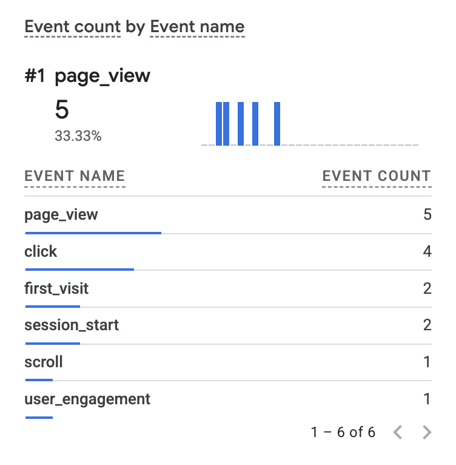
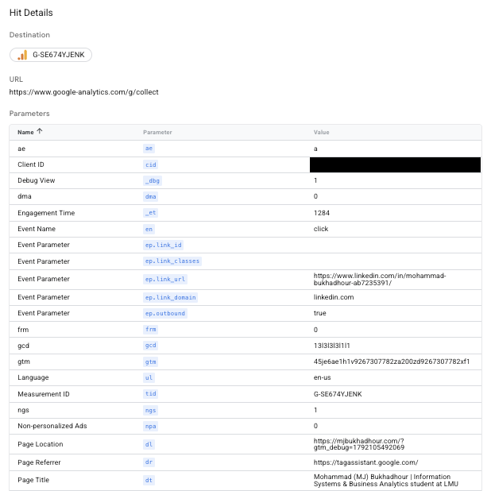

# Exercise 06 evidence: domain email and Google Analytics

## 1. Email tests

Times are PT, Oct 13, 2026.

| Test | Time | Result |
|------|------|--------|
| Received "Test 01: inbound" in Zoho | 2:52 PM | Delivered |
| Replied "Re: Test 01: inbound" | 2:53 PM | Arrived in outside Gmail inbox, From is my domain (Zoho Mail), delivered after 3 seconds |
| Sent new "Test 02: outbound" | 2:56 PM | Arrived in outside Gmail inbox, From is my domain |

## 2. Authentication results

Read from Gmail "Show original" on the reply:

- SPF: PASS with IP 165.173.180.52
- DKIM: PASS with domain mjbukhadhour.com
- DMARC: PASS

## 3. Live site and GA4

- Site: https://mjbukhadhour.com
- Privacy page: https://mjbukhadhour.com/privacy

GA4 Realtime showing `page_view` and `click`:

Tag Assistant hit details for the outbound click on the LinkedIn link, showing
`link_url`, `link_domain` (`linkedin.com`) and `outbound` (`true`):

## Note: domain suspension

On Oct 16, Namecheap suspended mjbukhadhour.com over WHOIS contact verification and swapped the nameservers, so the site and mail DNS stopped resolving. The email and GA4 tests above were done Oct 13-15, before the suspension. On Oct 20 I verified my registrant email, the domain shows Active, and Namecheap again points to Cloudflare's nameservers (graham and piper). Confirmed Oct 20: Cloudflare nameservers (graham and piper) are in place, and the site, /privacy and the mail records resolve again.
