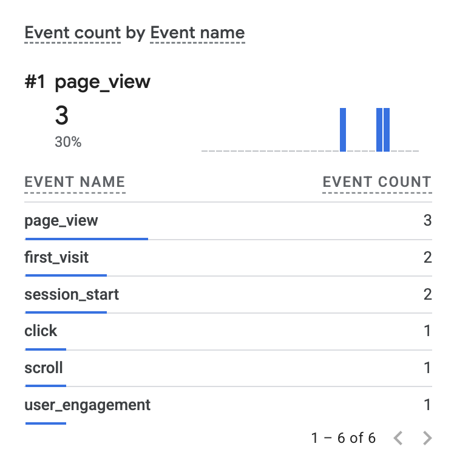

# Exercise 06 evidence: Test 04 (mail through the Zoho MCP server) and GA4 verification

Date: 2026-10-15

## 1. What was tested

Test 04 checks that an AI coding agent (Claude Code) can send mail from my
domain mailbox through the Zoho Mail MCP server, and that the message
authenticates and lands in the recipient's inbox like mail sent from the
Zoho web interface.

The `zoho-mail` MCP server was added to Claude Code at user scope and
authenticated with Zoho before the test. The server URL and its key are kept
out of this repo.

## 2. Send

| Item | Value |
|------|-------|
| Sent | 2026-10-15, 14:42 PDT (21:42 UTC) |
| Route | Zoho MCP server, `ZohoMail_sendEmail` tool |
| From | My domain address on `mjbukhadhour.com` |
| To | An outside Gmail address |
| Subject | Test 04: sent via Zoho MCP |
| Zoho API response | `200 success` |

## 3. Receive

| Check | Result |
|-------|--------|
| Delivered | Yes, Gmail Inbox |
| SPF | PASS |
| DKIM | PASS, domain `mjbukhadhour.com` |
| DMARC | PASS |

Results read from Gmail's "Show original" view.

## 4. Result

Test 04 passed. Mail sent by the agent through the Zoho MCP server left from
my `mjbukhadhour.com` address, passed SPF, DKIM and DMARC at Gmail, and was
delivered to the Inbox. This matches Tests 01 and 02, which were sent through
the Zoho web interface, so the MCP route authenticates the same way.

## 5. Live site

- Site: https://mjbukhadhour.com
- Privacy page: https://mjbukhadhour.com/privacy

The GA4 tag and the Privacy page were deployed to Railway in commit
`4cb9270`, "Add GA4 tag and Privacy page".

## 6. GA4 verification

Measurement ID: `G-SE674YJENK`. Checked 2026-10-15, session starting about
16:00 PDT, through GA4 Realtime and Tag Assistant.

| Event | Received | Key parameters |
|-------|----------|----------------|
| `page_view` | Yes, in Realtime | |
| `click` (outbound) | Yes, in Realtime and Tag Assistant | `link_url`: `https://www.linkedin.com/in/mohammad-bukhadhour-ab7235391/`, `link_domain`: `linkedin.com`, `outbound`: `true` |

Tag Assistant's hit details for the outbound click show it was sent to
`G-SE674YJENK` from page `https://mjbukhadhour.com/` with event name `click`.
The click was on the LinkedIn link in the site header.

Result: GA4 receives page views and outbound link clicks from the live site.

## 7. Consent control

On 2026-10-15, after confirming the tag worked, I added a cookie banner with
Accept and Decline buttons and a Cookie settings link in the footer, as my
professor asked. The GA tag now loads only after Accept. Decline deletes the
`_ga` and `_ga_SE674YJENK` cookies. The change is commit `e7caa8c`.

After deploying, I opened https://mjbukhadhour.com in a private tab on my
phone, clicked Accept and then LinkedIn. GA Realtime showed `page_view`,
`click` and other events (`first_visit`, `session_start`, `scroll`,
`user_engagement`):

