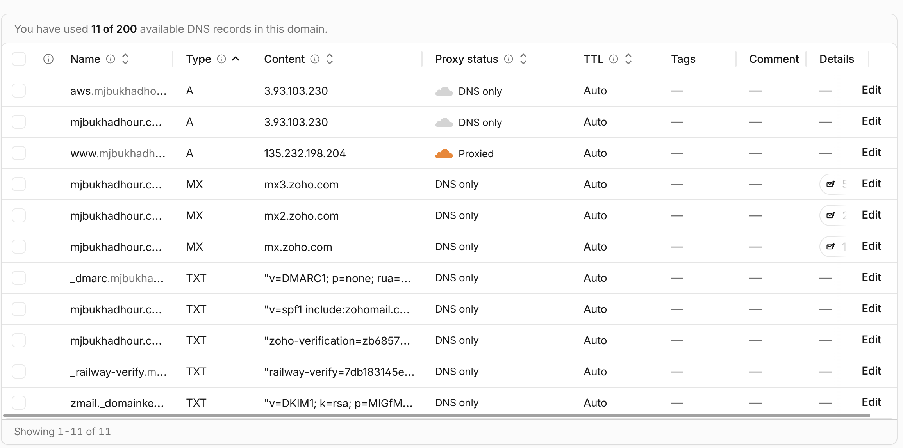
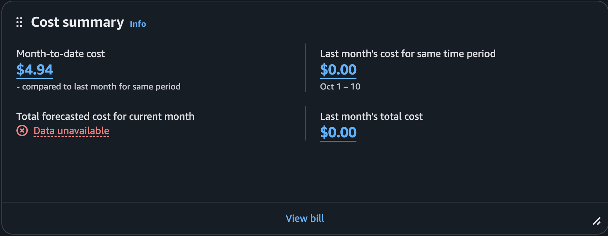

# Exercise 07 results: Railway to AWS

Full record: [`docs/aws-migration.md`](../aws-migration.md). Architecture
diagram: [README → Architecture → AWS](../../README.md#aws-current-since-2026-11-05).

## 1. Architecture decision

I chose **EC2 + Single-AZ RDS PostgreSQL**, and rejected EC2 with PostgreSQL
on the VM (I'd run the backups myself, and the app and database would fail
together) and Lambda + API Gateway (it needs app changes and a different
database connection setup). In return I accept another service to secure and
extra cost, with about $14 of the $34 a month going to RDS.

## 2. Backup record

| | |
| --- | --- |
| Restore test | Railway `pg_dump` from 2026-11-03 18:42 UTC, restored into a local database with no errors in 0.05 s. All 10 tables' row counts match the dump, and the app served the restored data (`GET /` 200). |
| Final backup | 2026-11-05 22:58 UTC, after the edit freeze. Restored into RDS with no errors in 0.19 s. Every table's MD5 on RDS is identical to the dump. |
| Copies | On the Mac and in OneDrive (checksums match), outside Git. Plus the RDS snapshot `career-platform-db-pre-cutover`. |
| Accepted data loss (RPO) | 1 week (weekly `pg_dump`). There was no loss at cutover. |
| Accepted recovery time (RTO) | 1 hour |
| Limitation: RDS backup retention | **1 day, not the planned 7.** The Free plan refused 2 to 7 days (`FreeTierRestrictionError`). The weekly `pg_dump`, kept outside AWS, and the manual snapshot are the main safety net. |

## 3. Verification on the test subdomain (`aws.mjbukhadhour.com`, 2026-11-05)

| Check | Evidence | Result |
| --- | --- | --- |
| Deployed commit | Server `HEAD` is `c3e1fea`, the same as `origin/main` | Pass |
| Records match the backup | Row count and MD5 per table are identical on RDS and the restored Nov 3 dump (10 of 10) | Pass |
| Target-only record survives a restart | Test row inserted into RDS, still there after `systemctl restart`, then deleted | Pass |
| Reboot | App, Nginx and the Certbot timer came back by themselves, the database answered, HTTPS 200 | Pass |
| Pages | `/`, `/privacy` and `/profiles/mj-bukhadhour` HTML is byte-identical to production. `/healthz` 200, unknown page 404 | Pass |
| Assets | `site.css` and `consent.js` are byte-identical to production | Pass |
| http → https | `http://aws.…/privacy` returns 301 to `https://aws.…/privacy` | Pass |
| HTTPS certificate | Let's Encrypt, valid Nov 5 2026 to Feb 3 2027, TLS 1.3, verify OK. Also checked by the owner in Chrome | Pass |
| Certificate renewal | `certbot renew --dry-run` succeeded and the timer is active | Pass |
| Restricted SSH | Port 22 is open only to my IP and passwords are off | Pass |
| RDS private | `PubliclyAccessible: False`, Single-AZ. 5432 is allowed only from the web server's security group: unreachable from the laptop, open from EC2 | Pass |
| Contact form (limitation) | A bad form returns 422. A valid one returns 502: there's no Resend key on AWS (or on Railway before it), so the server refuses the request before anything is sent | Not verified: email sending doesn't work |
| Analytics | `consent.js` is identical to production | Not verified: no live GA4 events checked |
| Actual costs | `isba-student` can't read billing; the owner checked the console on 2026-11-10 | Pass: charges seen ($4.94 month-to-date), credits not confirmed |
| Uploads | The app has no upload feature | Not applicable |

## 4. Cutover status

- **Moved to AWS:** 2026-11-05, about 23:07 UTC. The apex record changed from
  `CNAME → Railway` to `A → 3.93.103.230` (Elastic IP), DNS only. No other
  record changed.
- Afterwards, the production pages were byte-identical to Railway, the
  certificate was valid, http and `www` redirected, and real visitors were in
  the Nginx log.
- Railway was kept as a standby with identical data after cutover. **Status
  on 2026-11-10 (read-only CLI check):** the project `wholesome-solace` still
  exists, but both services (`career-platform` and `Postgres`) are offline,
  with every deployment `REMOVED`. The Railway domain returns Railway's
  fallback 404. Rolling back to Railway is no longer possible; the dumps and
  the RDS snapshot are the undo points. Why it went offline (for example, the
  trial ending) wasn't checked.

**DNS records in Cloudflare (2026-11-10):** the apex and `aws` are A records
to `3.93.103.230`, DNS only.

## 5. Cost

| | |
| --- | --- |
| Estimate | About **$34.09 a month** (us-east-1 On-Demand): EC2 t3.small $15.18, EBS 16 GB $1.28, public IPv4 $3.65, RDS db.t4g.micro $11.68, RDS storage 20 GB $2.30 |
| Credits | $120, expiring Apr 29, 2027. They cover the course but run out around Feb 2027 |
| Actual charges | $4.94 month-to-date on 2026-11-10 (Cost summary screenshot below). Last month: $0.00. The AWS free plan banner said credits cover free plan costs, so I expect no card charge, but I haven't confirmed that on the Credits page. |

