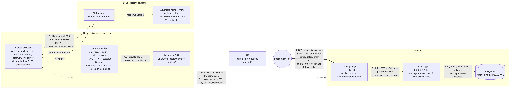
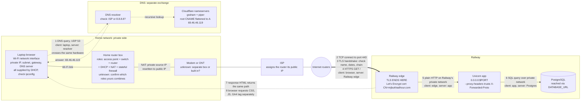
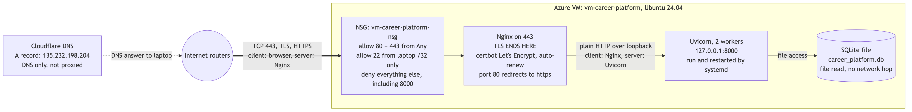
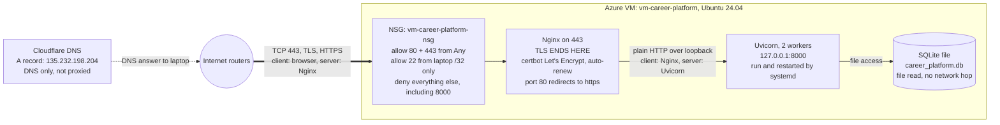

# Request path: mjbukhadhour.com

Study diagram for the midterm whiteboard interview. Items marked "check" or
"unknown" aren't in the repo; confirm them on your own network.

Assumptions: new HTTPS connection over TCP, no cached DNS answer, http
redirected to https.

## Railway: full request path

Mermaid source:

## Azure: what replaces the Railway box

Mermaid source:

## What changes between the two hosts

| | Azure | Railway |
| --- | --- | --- |
| DNS answer | A record to the VM, `135.232.198.204` | CNAME, flattened to `69.46.46.119` |
| Firewall | Your NSG rules | Railway's edge; you don't own it |
| Where TLS ends | Nginx on your VM | Railway's edge |
| Certificate | certbot on the VM (you renew it) | Railway (they renew it) |
| App listens on | `127.0.0.1:8000` | `0.0.0.0:$PORT` |
| Database | SQLite file on the same disk | PostgreSQL as a separate service |
| Who fixes it at 2 AM | You: OS, Nginx, certificate, app, database | Railway: servers, proxy, certificate. You: app and data |

## Say out loud while drawing

- The DNS lookup physically travels over the same Wi-Fi, router and ISP as
  the web request. It's drawn as a dotted side loop only to show it's a
  separate exchange.
- The host's logs show the router's public IP as the client, not the laptop's
  private IP, because of NAT.
